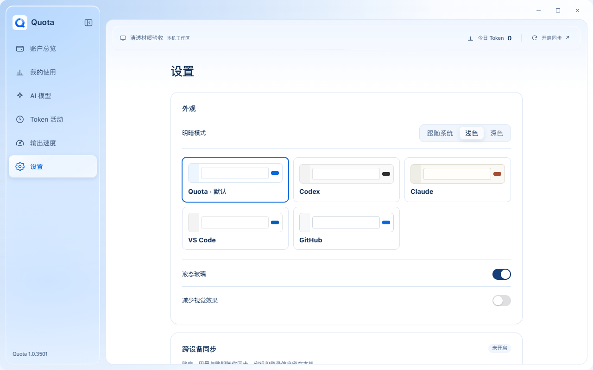
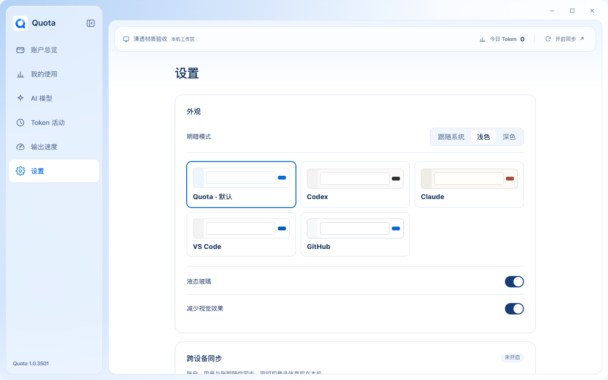
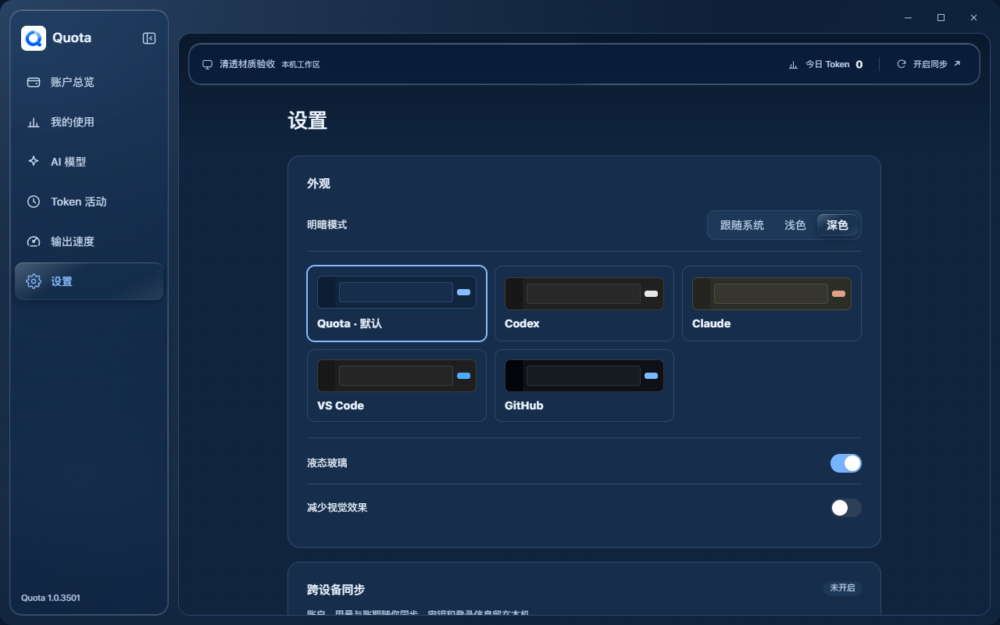
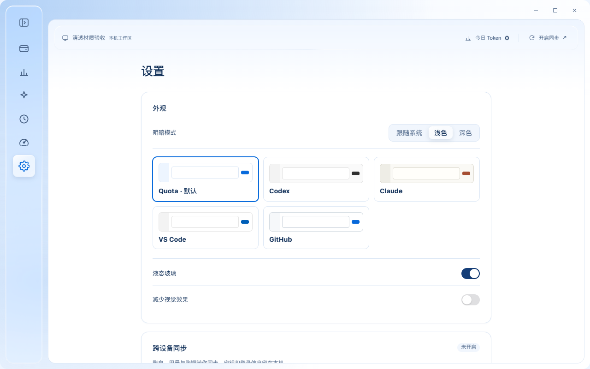
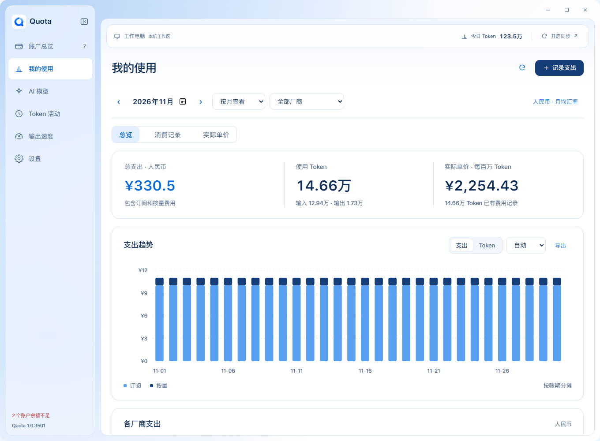
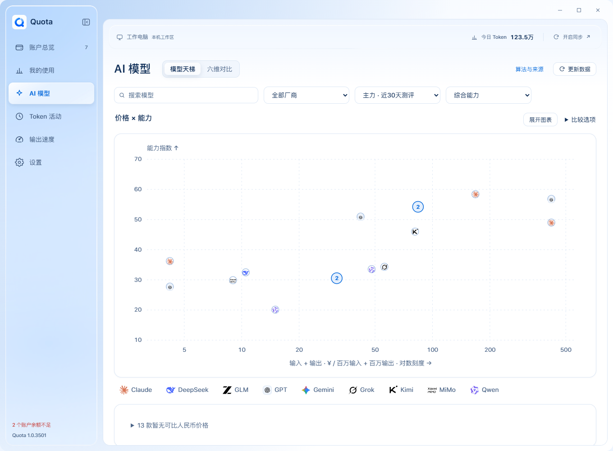
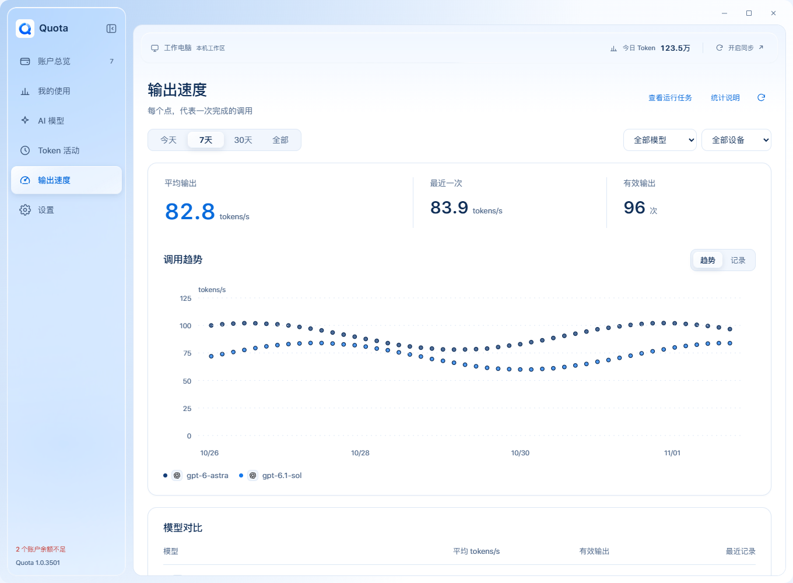

# Quota

[简体中文](README.md) · **English**

Quota brings AI account balances, subscription limits, spending, token usage, and model benchmarks into one desktop window.

Local-first · Windows and macOS · Light and dark themes · Tauri 2, Rust, and React

[Download and install](#download-and-install) · [Quick start](#quick-start) · [Features](#features) · [Screenshots](#screenshots) · [Development](#development)

## Download and install

Choose the installer for your platform. The links below follow the latest stable release. Both installers use the same release version.

| Platform | Latest download | Installation |
| --- | --- | --- |
| Windows x64 | [Download the installer](https://github.com/Sharanie0612/Quota/releases/latest/download/Quota-Windows-x64-setup.exe) | Quit the previous version of Quota, then run the installer. |
| macOS on Apple silicon | [Download the DMG](https://github.com/Sharanie0612/Quota/releases/latest/download/Quota-macOS-AppleSilicon.dmg) | Drag Quota into Applications. |

[Latest release notes](https://github.com/Sharanie0612/Quota/releases/latest) · [Previous releases and previews](https://github.com/Sharanie0612/Quota/releases) · [SHA-256 checksums](https://github.com/Sharanie0612/Quota/releases/latest/download/SHA256SUMS.txt)

Each release groups the installers and checksums together. GitHub also lists **Source code** archives for developers. Use the installer or DMG above to run the app. [Release guide](docs/releases.md)

The macOS package uses an ad hoc signature and has no Apple Developer ID signature or notarization. On first launch, macOS may ask you to allow the app under **System Settings → Privacy & Security**. Intel and Universal builds have no recorded validation. iPhone and iPad are unsupported.

Before upgrading, you can export your data from **Settings (设置) → Sync and Backup (同步与备份) → Backup and Migration (备份与迁移)**. The notes for each release list the platforms and scenarios verified for that release. The source package version is recorded in [package.json](package.json).

## Quick start

1. **Add an account.** In Account Overview (账户总览), choose a provider, enter an API key or connect through the provider’s sign-in flow, and save. The account name is optional. Other options are under Advanced Settings (高级设置).
2. **Record an expense.** In My Usage (我的使用), choose a month and select Record Expense (记录支出). Enter the provider, amount paid, and expense dates. The overview shows spending in CNY and the effective cost per million tokens. You can export the details as CSV.
3. **Enable the desktop widget.** Turn on the usage widget in Settings. Hover over its handle at the screen edge to see active model tasks. To sync across devices, select the same cloud drive or NAS folder on each device and connect your accounts locally on each one.

Top-up links open the provider’s website. Quota calculates statistics from the records available to it. Use the provider’s bill or subscription dashboard to confirm charges and remaining allowances.

## Features

| Page | What you can do |
| --- | --- |
| **Account Overview** | Check balances, remaining subscription allowances, query status, and low-balance alerts. Track cumulative top-ups and spending separately. |
| **My Usage** | Review CNY spending, token usage, and effective unit costs. Record and edit expenses, filter by month or provider, and export details. |
| **AI Models** | Compare the 30 most recently released models by Intelligence Index and Cost per Task. Search models, select by provider, and switch evaluation configurations. |
| **Token Activity** | Filter trends and usage shares by tool, model, or environment. Inspect the launcher, API access method, and model provider. |
| **Output Speed** | See one speed measurement per completed call. Filter by time, model, and device. The widget shows running tasks. |
| **Settings** | Configure themes, visual effects, collection frequency, notifications, the widget, backups, and cross-device sync. |

### My Usage

My Usage opens on the current month. Three views share the same date and provider filters.

- **Overview** shows total spending in CNY, tokens, and effective unit cost, followed by trends and spending by provider. Expand the usage breakdown to see models, providers, and devices.
- **Expense history** brings expenses in different currencies into one CNY table. Search, filter, edit, or export entries. The account spending changes panel lets you reconcile changes in cumulative spending and top-ups.
- **Effective unit cost** uses recorded expenses and the usage covered by those expenses to calculate CNY per million tokens. Expand a provider to see the models and expenses included.

USD expenses use the **arithmetic mean of published daily USD/CNY reference rates** for the expense month, derived from European Central Bank data. The current month updates as rates become available. Expenses spanning several months are split and converted month by month. The original amounts are retained. If a required rate is missing, the total stays pending. Open the CNY monthly exchange-rate control to see the dates and rates used.

Custom dates take effect when you apply them. Quota allocates expenses by calendar day, excludes top-ups from spending, and leaves unknown amounts or increments after a counter reset blank. My Usage excludes Trae. [Activity and cost calculations](docs/activity-stats.md)

### AI Models

- The chart plots the Artificial Analysis (AA) Intelligence Index against the weighted cost per task in USD for the same evaluation configuration. Cost uses a logarithmic axis. Select a point to inspect the model and configuration.
- The default selection contains the 30 newest models with known release dates. Search by model or provider, add or remove models, or switch evaluation configurations. Models without a comparable cost remain in the list. Your selection is saved locally.
- Connect AA to refresh manually or enable automatic updates. Quota replaces the local snapshot after all pages have been received. The previous snapshot remains available during a network failure or rate limit. Export the current selection as CSV.

Cost per task measures the cost of running AA’s evaluation. Official per-token prices have their own provider sources and verification dates. [Benchmarks and cost methodology](docs/model-benchmarks.md)

### Output Speed

The default view covers the past seven days. Each point plots one call’s completion time and measured output speed. Calls are shown individually, including when multiple calls fall within the same time interval. Filter by model or device. At short time ranges, the axis shows seconds. Hover, click, or use the arrow keys to see completion times down to the millisecond. Expand Records to see more responses. The mean is weighted by output duration.

The screen-edge widget shows running tasks, model names, start times, elapsed time, and today’s and all-time token totals.

**Speed updates when a response has complete usage data.** The local Codex collector can observe text events, but those events do not supply reliable per-token counts. A valid sample requires at least 64 non-reasoning output tokens and 0.5 seconds of output. [Measurement details](docs/output-speed.md)

### Token Activity

- Filter directly by tool, environment, and original model ID. Additional filters include the launcher (such as Multica), access method, and model provider. Filters apply to the current report. Configure collection in **Settings → Collection Sources (采集来源)**.
- Donut charts show the shares by source, model, and input caching. Hover to see a percentage or select a segment to filter the view.
- Trae distinguishes models provided by Trae from models connected through an API. Each channel can be filtered by model. Older records with insufficient evidence retain their unknown attribution.
- SSH devices show their names, connection aliases, and usage. Aliases for the same device are deduplicated by device identity. New devices start unselected. Deselecting a device preserves its history so its usage can be included again later.
- SSH collection uses existing connection settings to read metrics on the remote machine, without installing Quota there or setting up a shared directory. SSH sources and Quota sync clients are shown separately, along with connection failures and collection progress.

Collectors can read sources such as Codex, Claude Code, Gemini CLI, Kimi Code, ZCode, and DeepSeek Harness. Cursor requires a CSV with complete token details. Qoder requires usage fields in its logs. For WorkBuddy, select a compatible usage file. You choose which newly discovered SSH or WSL environments to include. The source guide lists formats and the scope of testing for each one. [Collection sources and environments](docs/activity-workspace.md)

Cached and reasoning tokens are already included in input and output totals. Token Activity keeps Trae’s original records, while My Usage excludes them. [Counting and sync rules](docs/activity-stats.md) · [1.0.2500 release notes](docs/release-1.0.2500.md)

### Appearance and desktop behavior

The default Quota theme uses white content panels, a pale blue sidebar, and a dark blue accent. The Codex, Claude, VS Code, and GitHub themes offer grayscale, warmer colors, editor-style sections, or distinct borders. Each supports light, dark, and system modes.

Settings offers two related appearance controls.

- **Liquid Glass** applies in-app background refraction and edge highlights to navigation and floating toolbars. The selection highlight changes shape and can respond to another selection mid-transition.
- **Reduce Visual Effects** appears when Liquid Glass is enabled. It softens refraction and transparency and uses fades for navigation and sidebar transitions. Quota remembers this preference if you turn off Liquid Glass.

Glass is used on navigation and interactive surfaces. Bills, charts, forms, and ordinary buttons stay legible on solid surfaces. The Windows implementation samples the app’s own background and confines pointer highlights to the active control. [Apple’s material guidelines](https://developer.apple.com/design/human-interface-guidelines/materials)

Appearance preferences are saved locally. Existing frosted-glass preferences migrate with both switches enabled. System high contrast restores solid surfaces. Reduced motion preserves the material while disabling position tracking and movement transitions. Keyboard focus takes priority over pointer highlights. Losing focus, hiding the window, or changing zoom clears the previous pointer position.

The keyboard-accessible sidebar toggle sits in the title row. The collapsed sidebar uses 24 px icons and 48 px click targets. On Windows, the floating main window uses per-pixel transparency for rounded corners and squares them when maximized or snapped. The always-on-top widget follows its rounded outline as it expands and collapses. Once collapsed, only its edge handle receives pointer input.

### Supported accounts

| Account type | Available information | Connection |
| --- | --- | --- |
| DeepSeek | Balance | API key |
| Kimi / Moonshot | Balance | API key |
| Zhipu GLM | Balance | API key, using an account reporting endpoint outside the official documentation |
| Xiaomi MiMo pay-as-you-go | Balance and usage this month | Isolated official sign-in window |
| Xiaomi MiMo subscription / Token Plan | Remaining plan allowance and usage this month | Official sign-in, which can reuse the pay-as-you-go account connection |
| ChatGPT subscription | Short-term and weekly Codex allowances | Explicitly connect the local Codex sign-in |

The ChatGPT card shows the subscription’s **Codex allowance**. Quota uses the existing sign-in without copying or refreshing Codex tokens. If a query fails, retry, open the provider’s site, or enter a manual balance. Missing cumulative top-up or spending amounts stay unknown until supplied. The lists of account providers and benchmarked model providers are maintained separately.

Provider prices use the official standard rate and retain the source, conditions, and verification time. An unverified price stays unknown. [Provider capabilities](docs/providers.md) · [Model pricing rules](docs/model-catalog.md)

## Screenshots

These screenshots show version 1.0.3501. The materials and sidebar were captured in the WebView of an isolated installation. The spending and chart examples come from a preview of the same build. All examples use synthetic data and contain no desktop background overlay.





<details>
<summary>Dark mode, collapsed sidebar, and report pages</summary>











</details>

## Data and sync

Configuration and statistics are stored locally in `%APPDATA%\Quota\` on Windows and `~/Library/Application Support/Quota/` on macOS.

- API keys, AccessKeys, management keys, and Xiaomi cookies use the operating system’s credential store. **Custom request headers and bodies are saved in `config.json`. Keep secrets out of these fields.**
- Activity collection retains metrics and excludes conversation content, tool arguments, and credentials. SSH connection details and device selections stay local. Activity sync carries metrics and the device names it needs.
- Ordinary backups omit sign-in information. To include eligible credentials, explicitly choose to include sign-in information and set a password for an encrypted backup. Codex tokens are excluded from backups.
- Users select their own shared folder. An existing cloud drive client or NAS handles transport. Account sync excludes sign-in credentials. The cloud client reports whether an upload has completed.

Real macOS credential access and cross-device cloud transfers still need on-device verification. [Security rules](docs/security.md) · [Backup and migration](docs/data-migration.md) · [Account sync](docs/account-sync.md)

## Development

Install Node.js, stable Rust, and the Tauri build prerequisites for your platform. On the maintainer’s Windows machine, build from a non-C drive and check the actual paths before installing dependencies. [Windows build path checks](docs/build-windows.md#维护者本机的构建位置)

```bash
git clone https://github.com/Sharanie0612/Quota.git
cd Quota
npm ci
npm run tauri dev
```

The development server uses port `1420`. Check your worktree and task branch before editing, then choose checks for the affected code. [Repository coding rules](AGENTS.md)

| Platform | Build entry point | Output |
| --- | --- | --- |
| Windows | `npm run package:windows` or `build-installer.cmd` | The GNU toolchain builds an NSIS installer that includes WebView2Loader.dll. |
| macOS | [macOS build guide](docs/build-macos.md) | Apple silicon app and DMG, with platform-specific resources. |

The macOS workflow stores build artifacts in GitHub Actions. Public installers are distributed through Releases. [Windows build guide](docs/build-windows.md)

```text
src/main.tsx + window.ts  Window entry points
src/views/               Six workspace pages and the setup wizard
src/components/          Shared controls, charts, and widget
src/lib/appearance/      Themes, preference validation, state, and sync
src/lib/                 API wrappers and business calculations
src/styles/              Base, layout, controls, pages, motion, and materials
src-tauri/src/           Commands, domain services, storage, and native windows
src-tauri/data/          Official source data and shared corner geometry
scripts/lib/             Loaders, synthetic fixtures, and rendering checks
```

```bash
npm run typecheck
npm run build
npm run verify
cargo check --locked --manifest-path src-tauri/Cargo.toml
```

For UI checks, start `npm run preview:ui` after the frontend build, then run `npm run verify:ui` in another terminal. The checks use Playwright and Edge. Set `QUOTA_PLAYWRIGHT_MODULE`, `QUOTA_BROWSER_PATH`, or `QUOTA_PREVIEW_URL` as needed. Coverage includes theme combinations, the 1024 px layout, expense editing, model charts, output speed, and the widget. Installed builds have separate checks.

On the maintainer’s Windows GNU setup, `cargo test` has a known WinRT DLL loading limitation. Run the relevant Rust example from `src-tauri/` to check compatibility with existing accounts, spending records, statistics, and sync formats. The development guide lists the checks for each kind of change. [Architecture](docs/architecture.md) · [Development and verification](docs/development.md) · [Repository coding rules](AGENTS.md)

## Documentation and contributions

The project guides linked below are in Chinese.

[Activity statistics](docs/activity-stats.md) · [Model catalog](docs/model-catalog.md) · [Architecture](docs/architecture.md) · [Contributing](CONTRIBUTING.md) · [Git workflow](docs/git-workflow.md)

Write commit and PR titles in English using `type(scope): summary`. Use the four English PR sections Summary, Changes, Version impact, and Testing. Include the base and target display versions and report the checks you ran. Update both READMEs when installation, features, or development instructions change. Use synthetic data in examples, screenshots, and logs, and cite verified official sources for prices. [Pull request template](.github/pull_request_template.md)

The project has no repository-wide open-source license granting permission to modify or redistribute it. The brand asset guide records artwork attribution and notices. [Brand assets](src/assets/brands/README.md)
