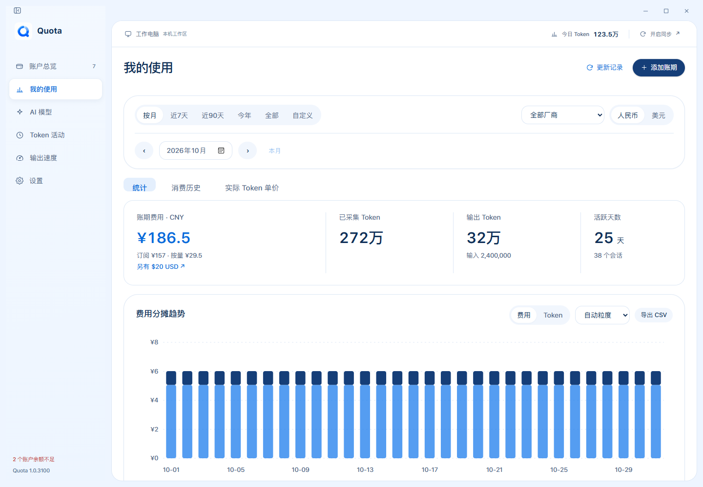
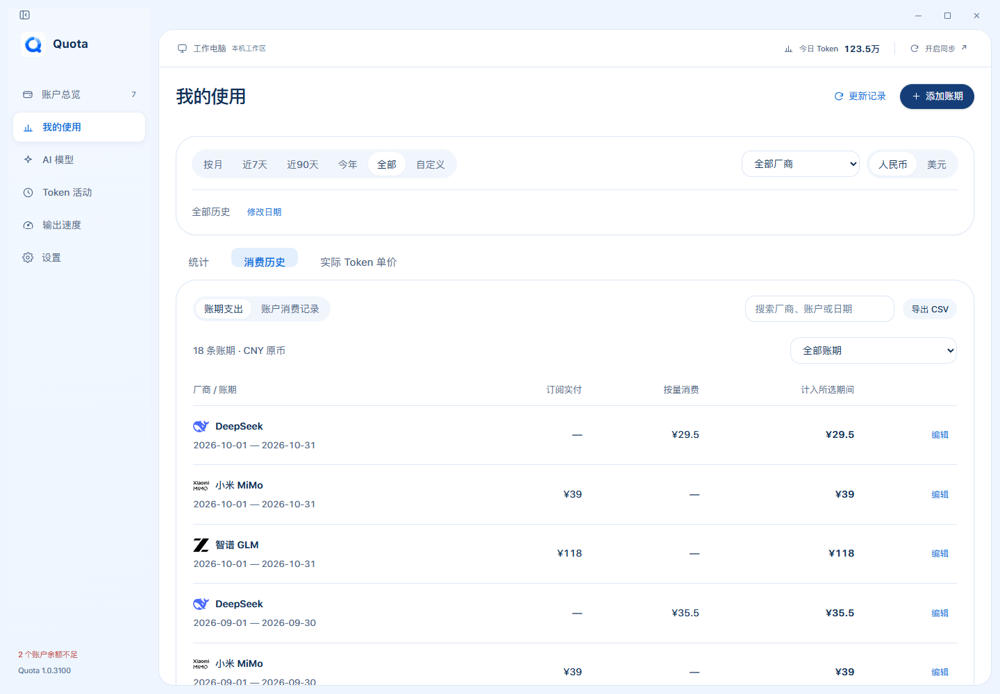
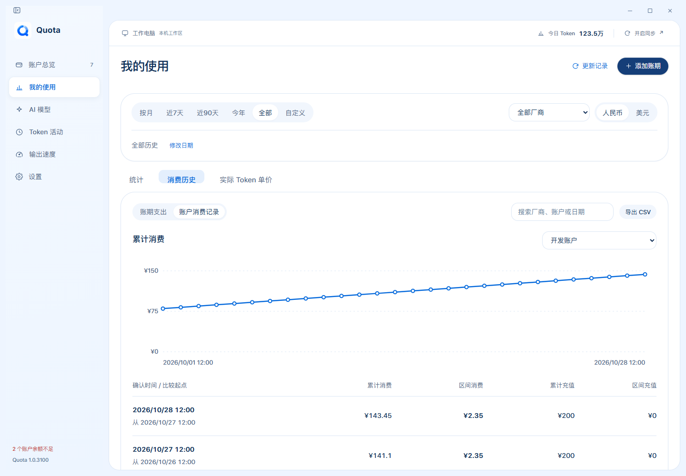
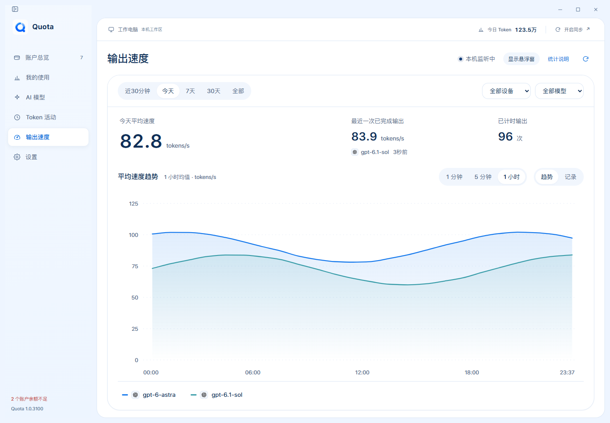
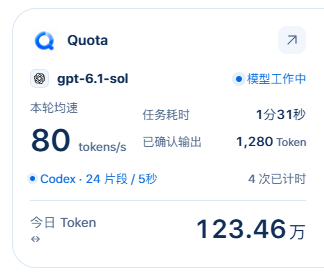
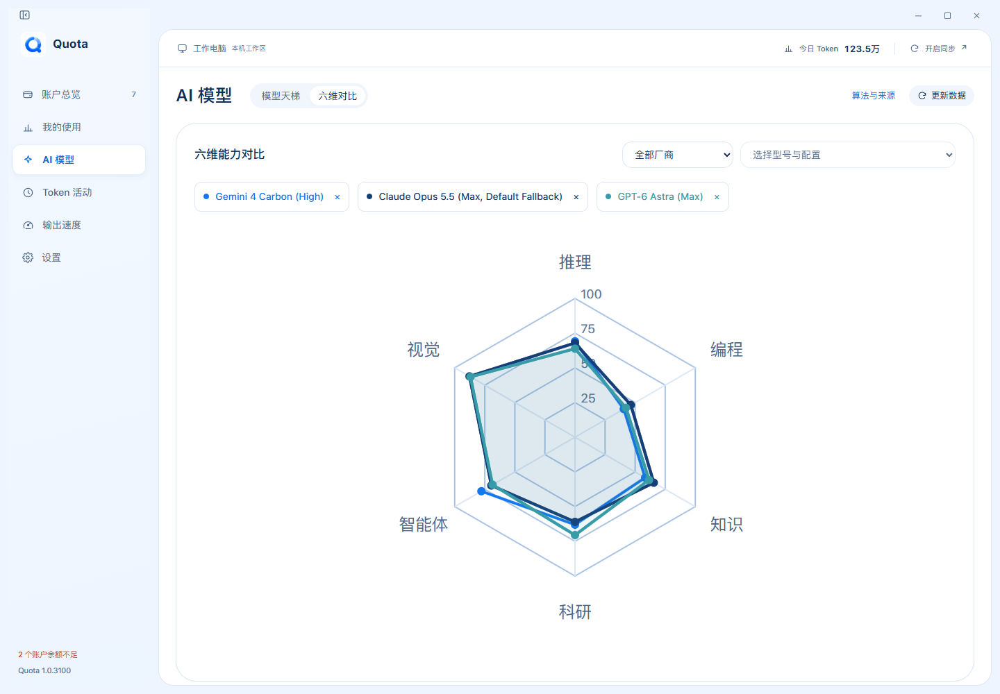
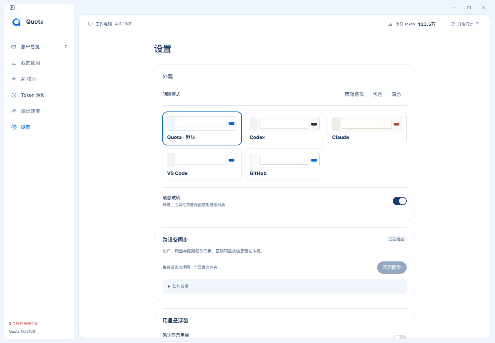
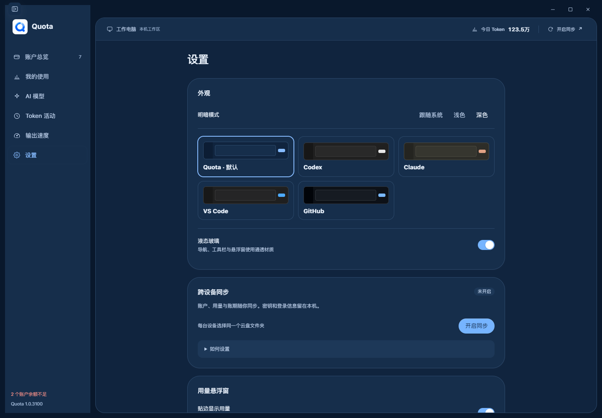

# Quota

把 AI 账户余额、订阅额度、实际支出、Token 活动和模型能力放进同一个桌面窗口。

本地优先 · Windows / macOS · 浅色与深色模式 · Tauri 2 + Rust + React

[下载安装](#下载安装) · [开始使用](#开始使用) · [功能](#功能) · [界面预览](#界面预览) · [开发](#开发)

## 下载安装

直接选择你的平台下载。两个平台共用同一发布版本，固定链接会跟随最新正式发布版本更新。

| 平台 | 下载最新版 | 安装方式 |
| --- | --- | --- |
| Windows x64 | [下载安装包](https://github.com/Sharanie0612/Quota/releases/latest/download/Quota-Windows-x64-setup.exe) | 退出旧版后运行安装器 |
| macOS Apple Silicon | [下载 DMG](https://github.com/Sharanie0612/Quota/releases/latest/download/Quota-macOS-AppleSilicon.dmg) | 将 Quota 拖入「应用程序」 |

[最新版本说明](https://github.com/Sharanie0612/Quota/releases/latest) · [历史版本 / 测试版](https://github.com/Sharanie0612/Quota/releases) · [SHA-256 校验](https://github.com/Sharanie0612/Quota/releases/latest/download/SHA256SUMS.txt)

每个版本集中提供两个平台的安装包和校验文件。GitHub 自动显示的 **Source code** 是源码压缩包，安装请选择上表中的文件。版本规则和发布步骤见 [发布管理](docs/releases.md)。

macOS 包采用临时签名，尚未进行 Apple Developer ID 签名和公证；首次打开可能需要在「系统设置 → 隐私与安全性」中允许。Intel / Universal 包暂无验收记录。iPhone / iPad 暂不支持。

更新前可在「设置 → 备份与迁移」导出数据。源码支持某个平台，不代表该平台的当前安装包已经发布；验证范围见发布说明。

**当前开发版本为 1.0.3100**：重构「我的使用」、消费历史和输出速度，贴边悬浮窗增加模型工作状态，提供白 / 淡蓝 / 深蓝配色与液态玻璃开关。本轮为 Windows 本地交付，公开下载链接仍指向已发布版本；macOS 未完成本轮验收。详见 [交付记录](docs/usage-live-1.0.3100.md)。

## 开始使用

1. **添加账户**：在「账户总览」选择平台，填入 API Key 或连接官方登录，保存即可。账户名称可选，其他参数收进「高级设置」。
2. **查看使用与支出**：在「我的使用」选择月份、厂商和币种，添加订阅或按量账期。消费历史可回看已保存的金额变化，当前统计可以导出 CSV。
3. **开启桌面状态**：在「设置」开启用量悬浮窗，鼠标移入屏幕边缘查看模型工作状态。跨设备使用时选择同一个云盘或 NAS 文件夹；登录信息在各设备单独配置。

充值入口只打开官方页面。统计基于实际保留的记录，不能替代厂商账单或订阅额度。

## 功能

| 页面 | 主要用途 |
| --- | --- |
| **账户总览** | 余额、订阅余量、查询状态与低余额提醒；累计充值和消费分别记录 |
| **我的使用** | 按月 / 周 / 自定义范围分析用量与费用，查看历史账期及账户消费，导出 CSV，核对实际 Token 单价 |
| **AI 模型** | 人民币价格 × 公开配置能力天梯，当前主力、近30天更新测评及六维对比 |
| **Token 活动** | Codex、ZCode、Harness、可选 Trae 的趋势与环形占比，按来源、模型和设备筛选 |
| **输出速度** | 已完成响应的加权速度曲线，按时间、模型、设备筛选；悬浮窗显示当前任务进度 |
| **设置** | 配色、明暗、液态玻璃、采集频率、通知、悬浮窗、备份和跨设备同步 |

### 我的使用

三个视图共用时间与厂商筛选：

- **统计**：按月、近 7 天、近 90 天、今年、全部或自定义日期查看；趋势可切换费用 / Token，以及日、周、月粒度。模型、厂商、设备用量可分别汇总。
- **消费历史**：查看完整账期列表，按状态筛选并编辑；账户消费曲线展示厂商返回的累计消费，明细保留消费与充值各自的变化。
- **实际 Token 单价**：保留厂商与模型明细，按已记录费用和同期覆盖用量计算每百万 Token 的实际成本。美元继续使用固定月度参考汇率。

统计趋势、分组用量和消费历史均可导出当前范围的 CSV。跨期费用按自然日分摊；未记录金额保持空缺，充值不计作消费，历史计数重置时不编造增量。「我的使用」继续排除 Trae；详细规则见 [活动与费用统计](docs/activity-stats.md)。

### AI 模型

- 主视图沿用价格与能力散点天梯，横轴统一人民币，默认各厂商当前主力型号，评分取最近30天公开更新的测评版本。
- 综合能力读取 AA v5 的非估算原始指数，固定完整推理配置；不混合不同榜单或不同档位的成绩。
- 保留六边形能力对比，六轴使用同一配置的真实分项，缺失留空。
- 价格只取官方标准 Token 单价；未测评、价格不明或汇率不可用时保留未知，不制造坐标。

[计算与来源](docs/model-benchmarks.md)。公开评测和官方价格分别更新，失败保留上次有效资料。

### 输出速度

主页面集中显示时段均速、最近一次输出和已计时次数。曲线支持时间、模型、设备及均值粒度筛选；空档保留，切到「记录」可逐条核对 Token 与耗时。

贴边悬浮窗顶部显示当前模型、任务耗时、已确认输出和本轮均速；多个本机任务可切换查看。本机以 1 秒为目标周期检查新增记录，可用时另显示 Codex 最近 5 秒的接收片段数。

**速度只在响应用量完整后更新。** 接收片段是本机 Codex 的全局活动信号，不能归属到所选模型，也不等于 Token。现有来源不提供逐 Token 计数，不根据字符数、心跳或任务总耗时伪造实时 tokens/s。有效输出至少 64 Token、0.5 秒，均值按输出时长加权。[完整口径](docs/output-speed.md)。

### Token 活动

- 时间、更新和采集设置集中在顶部；设备、来源、模型 / 厂商筛选按需展开。筛选只限定当前统计视图，不改变采集配置。
- 来源、模型与输入缓存占比使用环形图，移除图下冗余数据，悬停查看比例、点击扇区筛选。
- Trae 分开显示「Trae 提供」和「API 接入 Trae」，各通道可筛选具体模型并查看用量趋势。历史记录无法识别时保留未知。
- SSH 设备逐台显示名称、连接别名和独立用量。同一设备的多个别名按设备身份去重；新设备默认不选，取消勾选保留历史，重新勾选后恢复统计。
- SSH 使用已有连接配置，在远端只读提取指标，无需安装 Quota 或配置共享目录。SSH 用量来源与 Quota 同步客户端分列；连接失败和补采进度可见。

缓存和推理是输入 / 输出的子项，不重复加入总量。「我的使用」排除 Trae，Token 活动保留其原始指标。详见 [统计口径与同步](docs/activity-stats.md)、[1.0.2500 更新说明](docs/release-1.0.2500.md)。

### 外观与桌面

默认 Quota 使用白色内容区、淡蓝侧栏和深蓝强调色，与 Logo 保持一致。Codex、Claude、VS Code、GitHub 配色分别保留灰阶、暖色、编辑器分区与清晰边线的特点，均支持明暗和跟随系统。

「设置 → 外观 → 液态玻璃」可为导航、工具栏和悬浮窗开启通透材质，默认关闭。它是 Quota 的跨平台视觉实现；Windows 悬浮窗可结合系统 Acrylic，不依赖 Apple 私有接口。系统减少动效或高对比度模式下会降低相关效果。

侧栏收起时先完成布局，再做位移动画，减少图表反复重排。贴边弹窗使用固定画布展开，支持中途反向、拖动贴边及键盘收起。Windows 主窗口保留浮动圆角与最大化 / 分屏直角，安装器保留中文 / 英文向导。

### 支持的账户

| 账户类型 | 查看内容 | 连接方式 |
| --- | --- | --- |
| DeepSeek | 余额 | API Key |
| Kimi / Moonshot | 余额 | API Key |
| 智谱 GLM | 余额 | API Key；使用未收录于官方文档的账户报表接口 |
| 小米 MiMo 按量 | 余额、本月用量 | 隔离的官方登录窗口 |
| 小米 MiMo 订阅 / Token Plan | 套餐余量、本月用量 | 官方登录，可复用按量账户连接 |
| ChatGPT 订阅 | Codex 短期与每周额度 | 显式连接本机 Codex 登录 |

ChatGPT 显示的是订阅内 **Codex 额度**，Quota 不复制或刷新 Codex token。查询失败时可重试、打开官网或改用手动余额；未提供的累计充值 / 消费保持未知，可自行补全。账户支持范围与天梯厂商范围分别维护。

价格使用厂商官方标准档，保留来源、条件和核实时间。无法核实则标记未知，不猜数字。详见 [供应商能力](docs/providers.md) 和 [模型资料库规则](docs/model-catalog.md)。

## 界面预览

以下为 **1.0.3100** 构建后的真实前端预览。账户、账期、用量与运行状态使用合成数据；模型资料沿用已有公开快照。不代表个人账单、真实测速或 SSH 验收。



<details>
<summary>消费历史与模型工作状态</summary>









</details>

<details>
<summary>保留的模型对比与外观设置</summary>







</details>

## 数据与同步

配置与统计保存在本机：Windows 为 `%APPDATA%\Quota\`，macOS 为 `~/Library/Application Support/Quota/`。

- API Key、AccessKey、管理密钥与小米 Cookie 使用系统凭据库。**自定义接口的请求头和请求体会写入 `config.json`，不要在这些字段填写密钥。**
- 活动采集保存指标，不保存对话正文、工具参数或凭据。SSH 连接信息和设备选择留在本机；同步只携带指标及必要的设备名称。
- 普通备份省略登录信息；主动选择「包含登录信息」并设置密码后，可导出加密备份。Codex token 不在备份范围内。
- 共享目录由用户选择，传输依赖已有云盘客户端或 NAS。同步不传登录凭据；Quota 不确认文件是否已上传云端。

macOS 真实凭据读写和跨设备云端传输仍需实机验收。完整边界见 [安全规则](docs/security.md)、[数据迁移](docs/data-migration.md)、[账户同步](docs/account-sync.md)。

## 开发

准备 Node.js、Rust stable 和对应平台的 Tauri 构建依赖。

```bash
git clone https://github.com/Sharanie0612/Quota.git
cd Quota
npm ci
npm run tauri dev
```

开发端口为 `1420`。本轮本地工作分支为 `codex/feat/usage-live-polish`，尚未推送；不要假定远程仓库已有当前开发版。

| 平台 | 构建入口 | 说明 |
| --- | --- | --- |
| Windows | `npm run package:windows` 或双击 `build-installer.cmd` | GNU 工具链；产出 NSIS 安装包，需携带 WebView2Loader.dll |
| macOS | [macOS 构建指南](docs/build-macos.md) | Apple Silicon；产出 App / DMG，排除 Windows DLL |

Windows 详细环境见 [构建指南](docs/build-windows.md)。macOS 构建工作流的产物通过 GitHub Actions 保存；发布页中的文件才是公开安装包。

```bash
npm run typecheck
npm run build
cargo check --examples --locked --manifest-path src-tauri/Cargo.toml
node scripts/verify-logic.cjs
node scripts/verify-usage-analytics.cjs
node scripts/verify-vendor-costs.cjs
node scripts/verify-widget-motion.cjs
cargo run --release --manifest-path src-tauri/Cargo.toml --example activity_checks
cargo run --release --manifest-path src-tauri/Cargo.toml --example vendor_cost_checks
cargo run --release --manifest-path src-tauri/Cargo.toml --example output_speed_checks
```

本机 Windows GNU 环境使用 Rust example 验证运行逻辑，`cargo test` 存在 WinRT DLL 加载限制。界面检查使用 `prepare-preview.cjs`、`preview-server.cjs` 与 `verify-usage-workbench.cjs`；需可用的 Playwright / Edge，可用 `QUOTA_PLAYWRIGHT_MODULE`、`QUOTA_BROWSER_PATH`、`QUOTA_PREVIEW_URL` 指定环境。安装包需另做启动、增量采集和覆盖升级验证。更多检查见 [开发指南](docs/development.md) 和 [AGENTS.md](AGENTS.md)。

## 文档与贡献

[活动统计](docs/activity-stats.md) · [模型资料库](docs/model-catalog.md) · [架构](docs/architecture.md) · [贡献指南](CONTRIBUTING.md) · [Git 流程](docs/git-workflow.md)

提交请说明用户可见变化、验证结果与限制，不包含凭据、个人配置、真实账单或未经核实的价格。历史交付文档记录当时的验收范围。

项目尚未选择开源许可证，公开可读不代表已授予修改或再分发许可。品牌资源见 [图标说明](src/assets/brands/README.md)。
