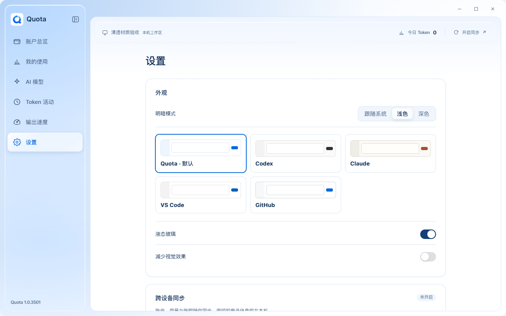
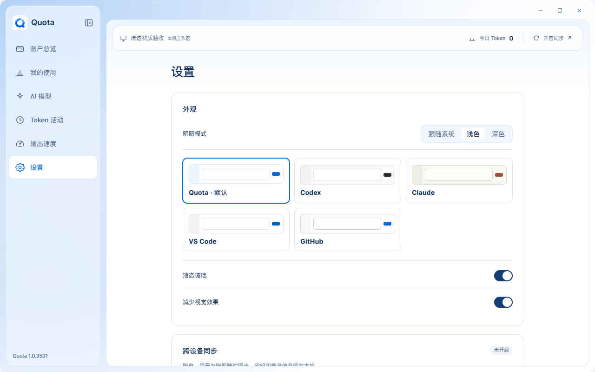
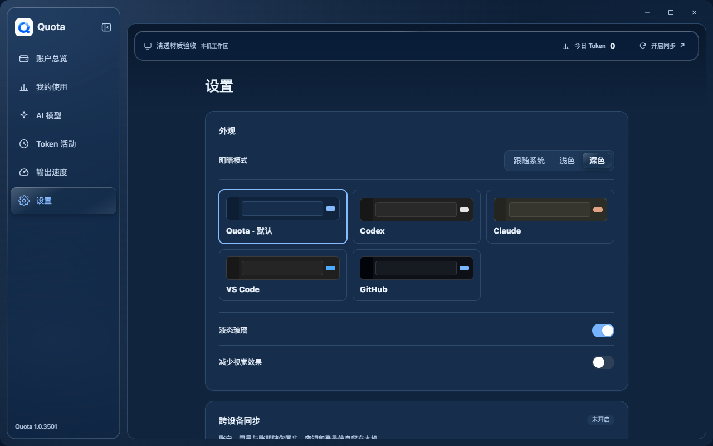
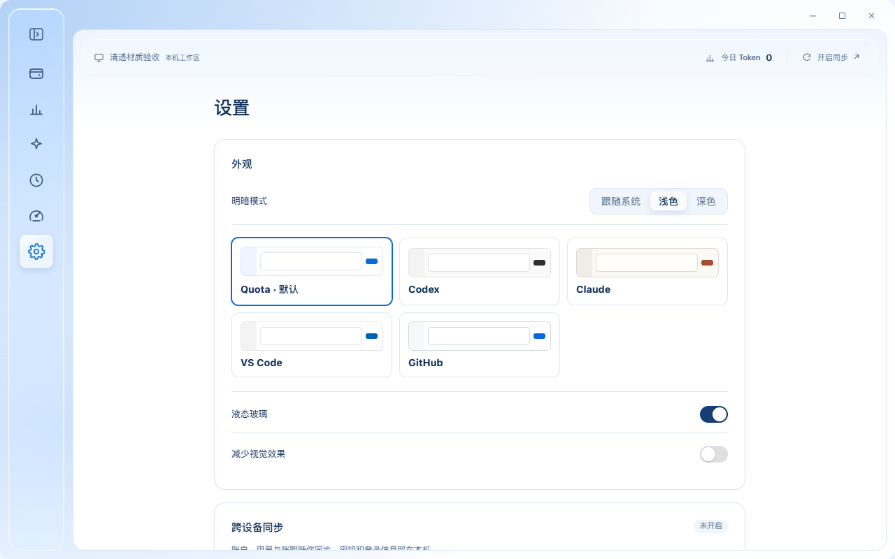
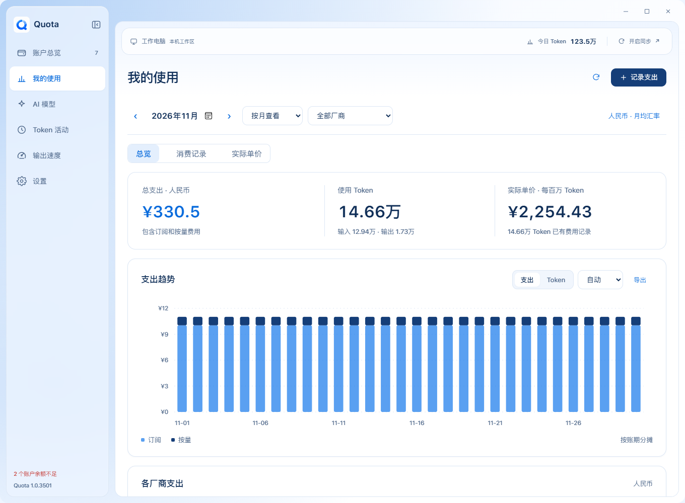
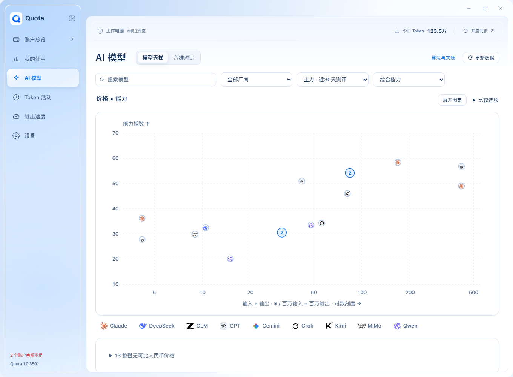
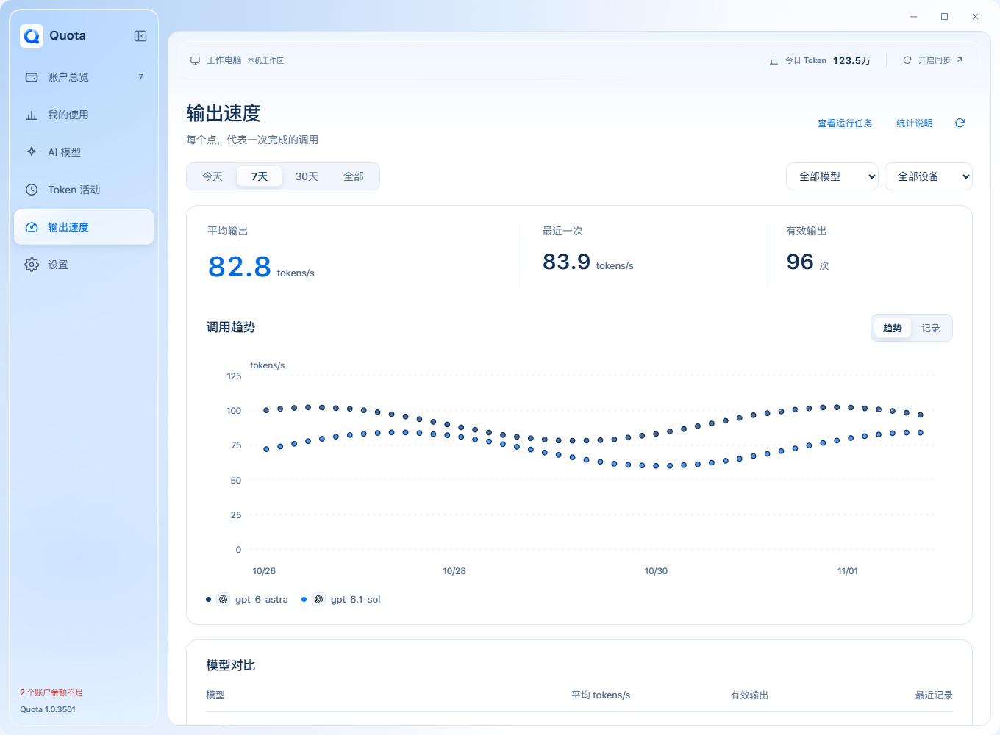

# Quota

把 AI 账户余额、订阅额度、实际支出、Token 活动和模型能力放进同一个桌面窗口。

本地优先 · Windows / macOS · 浅色与深色模式 · Tauri 2 + Rust + React

[下载安装](#下载安装) · [开始使用](#开始使用) · [功能](#功能) · [界面预览](#界面预览) · [开发](#开发)

## 下载安装

直接选择你的平台下载。两个平台共用同一发布版本，固定链接会跟随最新正式发布版本更新。

| 平台 | 下载最新版 | 安装方式 |
| --- | --- | --- |
| Windows x64 | [下载安装包](https://github.com/Sharanie0612/Quota/releases/latest/download/Quota-Windows-x64-setup.exe) | 退出旧版后运行安装器 |
| macOS Apple Silicon | [下载 DMG](https://github.com/Sharanie0612/Quota/releases/latest/download/Quota-macOS-AppleSilicon.dmg) | 将 Quota 拖入「应用程序」 |

[最新版本说明](https://github.com/Sharanie0612/Quota/releases/latest) · [历史版本 / 测试版](https://github.com/Sharanie0612/Quota/releases) · [SHA-256 校验](https://github.com/Sharanie0612/Quota/releases/latest/download/SHA256SUMS.txt)

每个版本集中提供两个平台的安装包和校验文件。GitHub 自动显示的 **Source code** 是源码压缩包，安装请选择上表中的文件。版本规则和发布步骤见 [发布管理](docs/releases.md)。

macOS 包采用临时签名，尚未进行 Apple Developer ID 签名和公证；首次打开可能需要在「系统设置 → 隐私与安全性」中允许。Intel / Universal 包暂无验收记录。iPhone / iPad 暂不支持。

更新前可在「设置 → 备份与迁移」导出数据。源码支持某个平台，不代表该平台的当前安装包已经发布；验证范围见发布说明。

**当前开发版本为 1.0.3501**：液态玻璃加入边缘透镜、随形高光与可打断的选择形变，顶部栏浮于滚动内容之上。「减少视觉效果」保留柔和玻璃层次，将位移与弹性改为淡入淡出。保留双开关、大图标侧栏、人民币月均换算、模型对比、实际 Token 单价、逐次调用散点和任务窗。公开下载仍指向已发布版本；本地验收见 [光学与减少动态记录](docs/liquid-optics-1.0.3501.md)。

## 开始使用

1. **添加账户**：在「账户总览」选择平台，填入 API Key 或连接官方登录，保存即可。账户名称可选，其他参数收进「高级设置」。
2. **记录一笔支出**：进入「我的使用」，选择月份，点击「记录支出」，填写厂商、实付金额和费用日期。总览会自动显示人民币总支出与实际单价，明细可导出 CSV。
3. **开启桌面状态**：在「设置」开启用量悬浮窗，鼠标移入屏幕边缘查看模型工作状态。跨设备使用时选择同一个云盘或 NAS 文件夹；登录信息在各设备单独配置。

充值入口只打开官方页面。统计基于实际保留的记录，不能替代厂商账单或订阅额度。

## 功能

| 页面 | 主要用途 |
| --- | --- |
| **账户总览** | 余额、订阅余量、查询状态与低余额提醒；累计充值和消费分别记录 |
| **我的使用** | 人民币总支出、使用 Token、实际单价；记录与编辑费用，按月份、厂商查询及导出 |
| **AI 模型** | 人民币价格 × 公开配置能力天梯，当前主力、近30天更新测评及六维对比 |
| **Token 活动** | Codex、ZCode、Harness、可选 Trae 的趋势与环形占比，按来源、模型和设备筛选 |
| **输出速度** | 每次调用的速度散点，按时间、模型、设备筛选；悬浮窗显示运行任务 |
| **设置** | 配色、明暗、视觉效果、采集频率、通知、悬浮窗、备份和跨设备同步 |

### 我的使用

默认打开本月，三个视图共用时间与厂商筛选：

- **总览**：先看人民币总支出、Token 和实际单价，再看趋势及各厂商费用。模型、厂商与设备的用量分布按需展开。
- **消费记录**：所有原币费用放进同一张人民币表格，支持搜索、筛选、编辑与导出。厂商的累计消费与充值变化在「账户消费变化」中核对。
- **实际单价**：按已记录费用和同期覆盖用量计算每百万 Token 的人民币成本，展开厂商查看模型与费用明细。

美元按费用所属月份的 **USD/CNY 日参考汇率算术均值**折算，数据来自 ECB。本月使用已公布日期的均值并定期更新，完整月份形成整月均值；跨月费用分别折算后相加，原币金额保留。缺少汇率时显示待换算，不把部分人民币金额当作总额。上方「人民币 · 月均汇率」可查看日期和换算值。

自定义日期只在点击应用后生效。跨期费用按自然日分摊；充值不计作消费，未知金额与计数重置的增量留空。「我的使用」继续排除 Trae。详细规则见 [活动与费用统计](docs/activity-stats.md)。

### AI 模型

- 价格与能力散点天梯统一人民币，横轴采用对数刻度，默认各厂商当前主力型号，评分取最近30天公开更新的测评版本。
- 靠得过近的型号显示数量，点击选择具体模型；放大后按新尺寸重新分组。分组保留每个型号的真实价格和分数。
- 综合能力读取 AA v5 的非估算原始指数，固定完整推理配置；不混合不同榜单或不同档位的成绩。
- 保留六边形能力对比，六轴使用同一配置的真实分项，缺失留空。
- 价格只取官方标准 Token 单价；未测评、价格不明或汇率不可用时保留未知，不制造坐标。

[计算与来源](docs/model-benchmarks.md)。公开评测和官方价格分别更新，失败保留上次有效资料。

### 输出速度

主页面默认近 7 天，每个点对应一次调用的完成时间与实际输出速度。散点不连线、不按时间桶合并，可按模型和设备筛选；短时间范围显示秒刻度，悬停、点击或方向键查看精确到毫秒的完成时间。「记录」可继续展开全部响应，顶部均值按输出时长加权。

贴边悬浮窗专注显示正在工作的任务、型号、开始时间与经过时长，保留今日 / 累计 Token；不再放置缺少实时计量依据的速度数字。

**速度只在响应用量完整后更新。** Codex 能提供文本流事件，但当前本机采集通道没有可靠的逐 Token 计数；文本片段数量与 Token 数不同。有效输出至少 64 Token、0.5 秒，均值按输出时长加权。[能力核实与统计口径](docs/output-speed.md)。

### Token 活动

- 时间、更新和采集设置集中在顶部；设备、来源、模型 / 厂商筛选按需展开。筛选只限定当前统计视图，不改变采集配置。
- 来源、模型与输入缓存占比使用环形图，移除图下冗余数据，悬停查看比例、点击扇区筛选。
- Trae 分开显示「Trae 提供」和「API 接入 Trae」，各通道可筛选具体模型并查看用量趋势。历史记录无法识别时保留未知。
- SSH 设备逐台显示名称、连接别名和独立用量。同一设备的多个别名按设备身份去重；新设备默认不选，取消勾选保留历史，重新勾选后恢复统计。
- SSH 使用已有连接配置，在远端只读提取指标，无需安装 Quota 或配置共享目录。SSH 用量来源与 Quota 同步客户端分列；连接失败和补采进度可见。

缓存和推理是输入 / 输出的子项，不重复加入总量。「我的使用」排除 Trae，Token 活动保留其原始指标。详见 [统计口径与同步](docs/activity-stats.md)、[1.0.2500 更新说明](docs/release-1.0.2500.md)。

### 外观与桌面

默认 Quota 使用白色内容区、淡蓝侧栏和深蓝强调色，与 Logo 保持一致。Codex、Claude、VS Code、GitHub 配色分别保留灰阶、暖色、编辑器分区与清晰边线的特点，均支持明暗和跟随系统。

「设置 → 外观」有两个关联的开关：

- **液态玻璃**：导航边缘折射应用内背景，高光随表面和鼠标位置变化，选中层可柔和形变并随时中断。
- **减少视觉效果**：开启液态玻璃后出现，降低折射与透明度，保留柔和的玻璃轮廓；导航和侧栏使用淡入淡出，取消移动和弹性。关闭主开关后仍记住这项选择。

按照 [Apple 材质指南](https://developer.apple.com/design/human-interface-guidelines/materials) 的层次，玻璃集中在导航和交互层；账单、图表、表单和普通按钮保持清晰。Windows版本使用应用自身背景，鼠标光效限制在目标表面内，避免影响文字和点击区域。

应用选择独立保存。旧版毛玻璃自动保留为“主开关开启 + 减少效果开启”。系统高对比度恢复实底，系统减少动态效果保留材质并停用位置追踪及移动过渡。键盘焦点优先于鼠标光效，失焦、隐藏和缩放会清理旧位置。

侧栏按钮位于标题行，收起后显示24px图标与48px点击区域，可用键盘操作。任务悬浮窗保持独立透明画布和命中区域；窗口浮动圆角和最大化 / 分屏方角继续保留。

### 支持的账户

| 账户类型 | 查看内容 | 连接方式 |
| --- | --- | --- |
| DeepSeek | 余额 | API Key |
| Kimi / Moonshot | 余额 | API Key |
| 智谱 GLM | 余额 | API Key；使用未收录于官方文档的账户报表接口 |
| 小米 MiMo 按量 | 余额、本月用量 | 隔离的官方登录窗口 |
| 小米 MiMo 订阅 / Token Plan | 套餐余量、本月用量 | 官方登录，可复用按量账户连接 |
| ChatGPT 订阅 | Codex 短期与每周额度 | 显式连接本机 Codex 登录 |

ChatGPT 显示的是订阅内 **Codex 额度**，Quota 不复制或刷新 Codex token。查询失败时可重试、打开官网或改用手动余额；未提供的累计充值 / 消费保持未知，可自行补全。账户支持范围与天梯厂商范围分别维护。

价格使用厂商官方标准档，保留来源、条件和核实时间。无法核实则标记未知，不猜数字。详见 [供应商能力](docs/providers.md) 和 [模型资料库规则](docs/model-catalog.md)。

## 界面预览

材质与侧栏来自 1.0.3501 隔离安装版的真实 WebView，费用与图表来自同一构建的合成预览。所有示例均使用合成资料，不叠加桌面背景。





<details>
<summary>深色、收起侧栏与业务页面</summary>











</details>

## 数据与同步

配置与统计保存在本机：Windows 为 `%APPDATA%\Quota\`，macOS 为 `~/Library/Application Support/Quota/`。

- API Key、AccessKey、管理密钥与小米 Cookie 使用系统凭据库。**自定义接口的请求头和请求体会写入 `config.json`，不要在这些字段填写密钥。**
- 活动采集保存指标，不保存对话正文、工具参数或凭据。SSH 连接信息和设备选择留在本机；同步只携带指标及必要的设备名称。
- 普通备份省略登录信息；主动选择「包含登录信息」并设置密码后，可导出加密备份。Codex token 不在备份范围内。
- 共享目录由用户选择，传输依赖已有云盘客户端或 NAS。同步不传登录凭据；Quota 不确认文件是否已上传云端。

macOS 真实凭据读写和跨设备云端传输仍需实机验收。完整边界见 [安全规则](docs/security.md)、[数据迁移](docs/data-migration.md)、[账户同步](docs/account-sync.md)。

## 开发

准备 Node.js、Rust stable 和对应平台的 Tauri 构建依赖。

```bash
git clone https://github.com/Sharanie0612/Quota.git
cd Quota
npm ci
npm run tauri dev
```

开发端口为 `1420`。本轮本地工作分支为 `codex/feat/apple-materials-sidebar`，尚未推送；不要假定远程仓库已有当前开发版。

| 平台 | 构建入口 | 说明 |
| --- | --- | --- |
| Windows | `npm run package:windows` 或双击 `build-installer.cmd` | GNU 工具链；产出 NSIS 安装包，需携带 WebView2Loader.dll |
| macOS | [macOS 构建指南](docs/build-macos.md) | Apple Silicon；产出 App / DMG，排除 Windows DLL |

Windows 详细环境见 [构建指南](docs/build-windows.md)。macOS 构建工作流的产物通过 GitHub Actions 保存；发布页中的文件才是公开安装包。

项目按入口、视图、公共组件、业务计算和桌面服务分层：

```text
src/main.tsx + window.ts  窗口入口
src/views/               六个业务页面与安装向导
src/components/          公共控件、图表与任务窗
src/lib/appearance/      配色、偏好校验、状态与同步
src/lib/                 API 封装与纯业务计算
src/styles/              基础、布局、控件、页面、动效、材质
src-tauri/src/           命令、业务服务、存储与原生窗口
src-tauri/data/          官方资料种子与共享圆角配置
scripts/lib/             验收共用的加载器、合成数据与表面检查
```

```bash
npm run typecheck
npm run build
npm run verify
cargo check --examples --locked --manifest-path src-tauri/Cargo.toml
```

界面检查先运行 `npm run preview:ui`，再在另一终端运行 `npm run verify:ui`。需要可用的 Playwright / Edge；可通过 `QUOTA_PLAYWRIGHT_MODULE`、`QUOTA_BROWSER_PATH`、`QUOTA_PREVIEW_URL` 指定环境。检查覆盖外观组合、1024px 布局、账务交互、模型图、速度与任务窗，安装版仍需单独验收。

本机 Windows GNU 的 `cargo test` 存在 WinRT DLL 加载限制，运行逻辑使用对应的 Rust example。账户、账务、统计和同步兼容代码及有效回归继续保留，已移除的旧页面与液态效果检查不再作为当前验收入口。分层边界、扩展方式与验证命令见 [架构](docs/architecture.md)、[开发指南](docs/development.md) 和 [AGENTS.md](AGENTS.md)。

## 文档与贡献

[活动统计](docs/activity-stats.md) · [模型资料库](docs/model-catalog.md) · [架构](docs/architecture.md) · [贡献指南](CONTRIBUTING.md) · [Git 流程](docs/git-workflow.md)

提交请说明用户可见变化、验证结果与限制，不包含凭据、个人配置、真实账单或未经核实的价格。历史交付文档记录当时的验收范围。

项目尚未选择开源许可证，公开可读不代表已授予修改或再分发许可。品牌资源见 [图标说明](src/assets/brands/README.md)。
