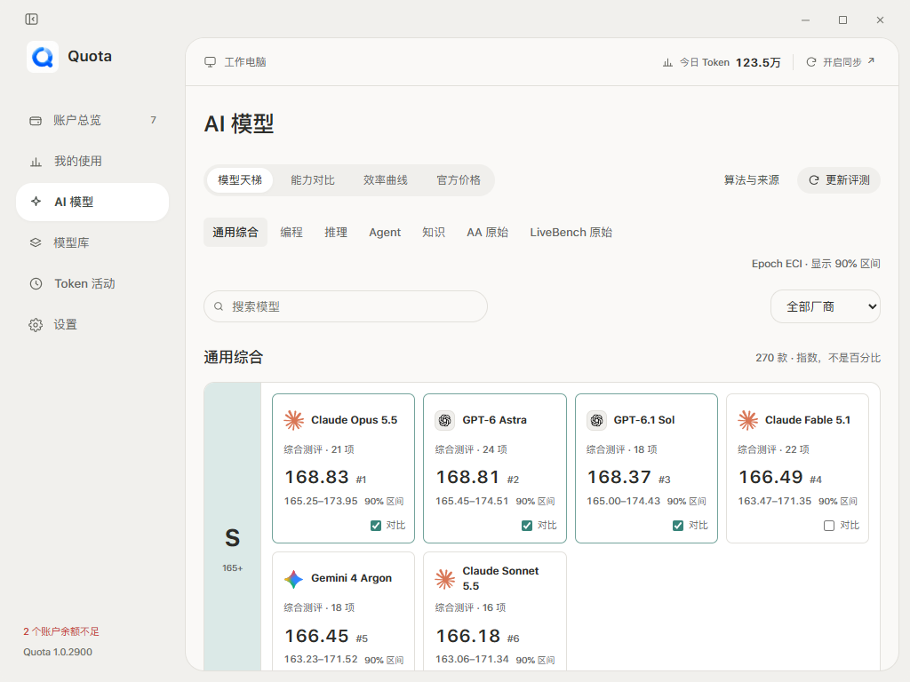
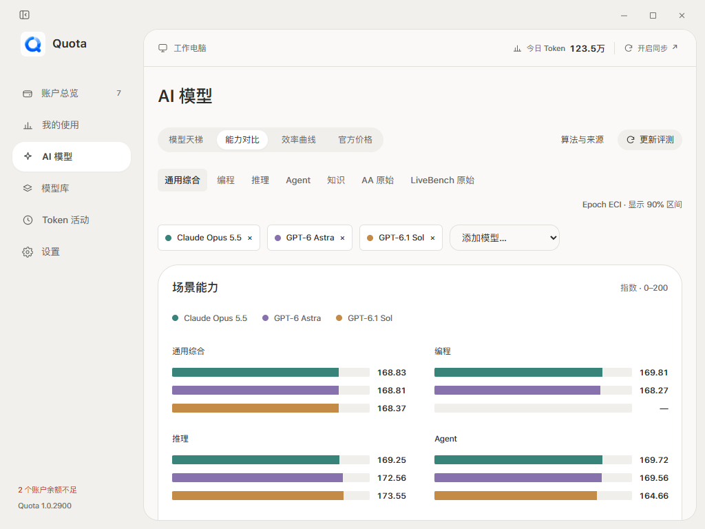
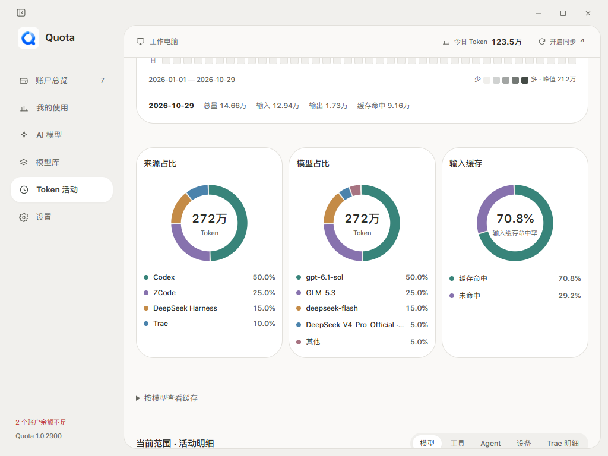
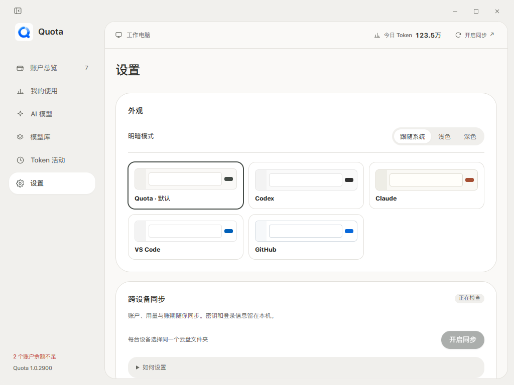
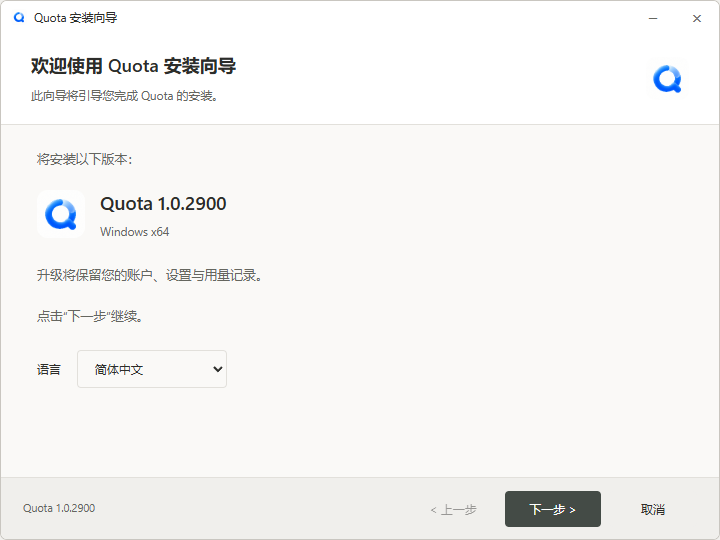

# Quota

把 AI 账户余额、订阅额度、实际支出、Token 活动和模型能力放进同一个桌面窗口。

本地优先 · Windows / macOS · 浅色与深色模式 · Tauri 2 + Rust + React

[下载安装](#下载安装) · [开始使用](#开始使用) · [功能](#功能) · [界面预览](#界面预览) · [开发](#开发)

## 下载安装

直接选择你的平台下载。两个平台共用同一发布版本，固定链接会跟随最新正式发布版本更新。

| 平台 | 下载最新版 | 安装方式 |
| --- | --- | --- |
| Windows x64 | [下载安装包](https://github.com/Sharanie0612/Quota/releases/latest/download/Quota-Windows-x64-setup.exe) | 退出旧版后运行安装器 |
| macOS Apple Silicon | [下载 DMG](https://github.com/Sharanie0612/Quota/releases/latest/download/Quota-macOS-AppleSilicon.dmg) | 将 Quota 拖入「应用程序」 |

[最新版本说明](https://github.com/Sharanie0612/Quota/releases/latest) · [历史版本 / 测试版](https://github.com/Sharanie0612/Quota/releases) · [SHA-256 校验](https://github.com/Sharanie0612/Quota/releases/latest/download/SHA256SUMS.txt)

每个版本集中提供两个平台的安装包和校验文件。GitHub 自动显示的 **Source code** 是源码压缩包，安装请选择上表中的文件。版本规则和发布步骤见 [发布管理](docs/releases.md)。

macOS 包采用临时签名，尚未进行 Apple Developer ID 签名和公证；首次打开可能需要在「系统设置 → 隐私与安全性」中允许。Intel / Universal 包暂无验收记录。iPhone / iPad 暂不支持。

更新前可在「设置 → 备份与迁移」导出数据。源码支持某个平台，不代表该平台的当前安装包已经发布；验证范围见发布说明。

**当前分支为 1.0.2900**：已完成 Windows 构建、1.0.2801 → 1.0.2900 覆盖升级与安装版验证。上方下载入口仍指向最近的正式发布，当前为 [1.0.2500](https://github.com/Sharanie0612/Quota/releases/tag/1.0.2500)。1.0.2900 尚未公开发布，macOS 本轮未验收，详见 [本轮交付记录](docs/scenario-evaluation-1.0.2900.md)。

## 开始使用

1. **添加账户**：在「账户总览」选择平台，填入 API Key 或连接官方登录，保存即可。账户名称可选，其他参数收进「高级设置」。
2. **查看活动**：在「Token 活动」点击「更新用量」，读取本机已有记录。SSH 设备、Trae 和自定义日志目录在「采集设置」中配置。
3. **按需同步**：在「设置」选择共享目录，各设备使用同一个云盘或 NAS 文件夹；登录信息在每台设备单独配置。

充值入口只打开官方页面。统计基于实际保留的记录，不能替代厂商账单或订阅额度。

## 功能

| 页面 | 主要用途 |
| --- | --- |
| **账户总览** | 余额、订阅余量、查询状态与低余额提醒；累计充值和消费分别记录 |
| **我的使用** | 按自然月或自定义日期看用量、订阅支出和实际单价；账期独立管理，美元按固定月度参考汇率折算 |
| **AI 模型** | 通用综合与编程、推理、Agent、知识分榜；场景对比、推理档位效率曲线、官方价格及原始测评对照 |
| **模型库** | 查看模型资料、官方价格与核实来源，隐藏或恢复型号 |
| **Token 活动** | 汇总 Codex、智谱 ZCode、DeepSeek Harness 和可选的 Trae 活动；查看趋势、来源与模型占比、输入缓存和设备明细 |
| **设置** | 管理配色、采集频率、通知、用量悬浮窗、备份、迁移和跨设备同步 |

### AI 模型

- **综合与场景分榜**：通用综合保留 Epoch 发布的 ECI 和 90% 区间；编程、推理、Agent、知识分榜使用公开测评难度与同一配置的原始记录计算。1.0.2900 内置快照覆盖 270 个综合型号、59 项测评校准，后续随来源更新。
- **可追溯的成绩**：详情分列原始成绩、基线校准值、完整配置及来源；AA、LiveBench 与厂商报告保留独立对照。配置冲突或缺少足够测评时保留未知。
- **能力与成本对比**：最多选择四款模型，对比综合与各场景；效率曲线展示同一 AA 配置的能力指数与实测任务成本，保留各推理档位。
- **官方价格**：自动检查支持厂商的确定性价格表，保留标准档、缓存命中与写入条件、来源和核实时间。无法核实的价格保持未知。

综合与场景指数使用校准尺度。场景的逐项留出范围表示敏感性，不是统计置信区间；综合榜相近型号的区间可能重叠。完整计算、配置选择与适用范围见 [模型测评说明](docs/model-benchmarks.md)。Epoch 数据采用 CC BY 4.0，署名及派生计算说明见 [数据来源](src-tauri/data/NOTICE-benchmark-data.md)。

测评与官方价格可以每日自动检查，也可在设置中关闭；来源更新失败时保留上次成功记录。

### Token 活动

- 时间、更新和采集设置集中在顶部；设备、来源、模型 / 厂商筛选按需展开。筛选只限定当前统计视图，不改变采集配置。
- 来源、模型与输入缓存占比使用环形图，图例显示比例并支持点击筛选。
- Trae 分开显示「Trae 提供」和「API 接入 Trae」，各通道可查看具体模型、输入、缓存命中、输出、总 Token 和会话数。历史记录无法识别时保留未知。
- SSH 设备逐台显示名称、连接别名和独立用量。同一设备的多个别名按设备身份去重；新设备默认不选，取消勾选保留历史，重新勾选后恢复统计。
- SSH 使用已有连接配置，在远端只读提取指标，无需安装 Quota 或配置共享目录。SSH 用量来源与 Quota 同步客户端分列；连接失败和补采进度可见。

缓存和推理是输入 / 输出的子项，不重复加入总量。「我的使用」排除 Trae，Token 活动保留其原始指标。详见 [统计口径与同步](docs/activity-stats.md)、[1.0.2500 更新说明](docs/release-1.0.2500.md)。

### 外观与桌面

默认 Quota 暖灰配色，也可选择 Codex、Claude、VS Code、GitHub 配色，并切换明暗或跟随系统。侧边栏支持收起；Windows 主窗口浮动时采用圆角，最大化、全屏及分屏采用直角。Windows 安装器提供中文 / 英文向导、目标目录、安装进度与完成页。

### 支持的账户

| 账户类型 | 查看内容 | 连接方式 |
| --- | --- | --- |
| DeepSeek | 余额 | API Key |
| Kimi / Moonshot | 余额 | API Key |
| 智谱 GLM | 余额 | API Key；使用未收录于官方文档的账户报表接口 |
| 小米 MiMo 按量 | 余额、本月用量 | 隔离的官方登录窗口 |
| 小米 MiMo 订阅 / Token Plan | 套餐余量、本月用量 | 官方登录，可复用按量账户连接 |
| ChatGPT 订阅 | Codex 短期与每周额度 | 显式连接本机 Codex 登录 |

ChatGPT 显示的是订阅内 **Codex 额度**，Quota 不复制或刷新 Codex token。查询失败时可重试、打开官网或改用手动余额；未提供的累计充值 / 消费保持未知，可自行补全。账户支持范围与天梯厂商范围分别维护。

价格使用厂商官方标准档，保留来源、条件和核实时间。无法核实则标记未知，不猜数字。详见 [供应商能力](docs/providers.md) 和 [模型资料库规则](docs/model-catalog.md)。

## 界面预览

以下为 **1.0.2900** 真实前端组件的浏览器预览。账户与活动使用演示数据，模型分数来自本轮公开快照；不代表真实账户、账单或 SSH 查询结果，榜单会随来源更新。



<details>
<summary>场景能力对比与 Token 占比</summary>





</details>

<details>
<summary>配色设置与 Windows 安装向导</summary>





</details>

## 数据与同步

配置与统计保存在本机：Windows 为 `%APPDATA%\Quota\`，macOS 为 `~/Library/Application Support/Quota/`。

- API Key、AccessKey、管理密钥与小米 Cookie 使用系统凭据库。**自定义接口的请求头和请求体会写入 `config.json`，不要在这些字段填写密钥。**
- 活动采集保存指标，不保存对话正文、工具参数或凭据。SSH 连接信息和设备选择留在本机；同步只携带指标及必要的设备名称。
- 普通备份省略登录信息；主动选择「包含登录信息」并设置密码后，可导出加密备份。Codex token 不在备份范围内。
- 共享目录由用户选择，传输依赖已有云盘客户端或 NAS。同步不传登录凭据；Quota 不确认文件是否已上传云端。

macOS 真实凭据读写和跨设备云端传输仍需实机验收。完整边界见 [安全规则](docs/security.md)、[数据迁移](docs/data-migration.md)、[账户同步](docs/account-sync.md)。

## 开发

准备 Node.js、Rust stable 和对应平台的 Tauri 构建依赖。

```bash
git clone https://github.com/Sharanie0612/Quota.git
cd Quota
npm ci
npm run tauri dev
```

开发端口为 `1420`。尚未合并的功能请切换到对应功能分支；当前 1.0.2900 为 `codex/feat/scenario-evaluation`。

| 平台 | 构建入口 | 说明 |
| --- | --- | --- |
| Windows | `npm run package:windows` 或双击 `build-installer.cmd` | GNU 工具链；产出 NSIS 安装包，需携带 WebView2Loader.dll |
| macOS | [macOS 构建指南](docs/build-macos.md) | Apple Silicon；产出 App / DMG，排除 Windows DLL |

Windows 详细环境见 [构建指南](docs/build-windows.md)。macOS 构建工作流的产物通过 GitHub Actions 保存；发布页中的文件才是公开安装包。

```bash
npm run typecheck
npm run build
cargo check --locked --manifest-path src-tauri/Cargo.toml
node scripts/verify-logic.cjs
node scripts/verify-ui-render.cjs
cargo run --release --manifest-path src-tauri/Cargo.toml --example activity_checks
```

本机 Windows GNU 环境使用 Rust example 验证运行逻辑，`cargo test` 存在 WinRT DLL 加载限制。更多检查见 [开发指南](docs/development.md) 和 [AGENTS.md](AGENTS.md)。

## 文档与贡献

[活动统计](docs/activity-stats.md) · [模型资料库](docs/model-catalog.md) · [架构](docs/architecture.md) · [贡献指南](CONTRIBUTING.md) · [Git 流程](docs/git-workflow.md)

提交请说明用户可见变化、验证结果与限制，不包含凭据、个人配置、真实账单或未经核实的价格。历史交付文档记录当时的验收范围。

项目尚未选择开源许可证，公开可读不代表已授予修改或再分发许可。品牌资源见 [图标说明](src/assets/brands/README.md)。
