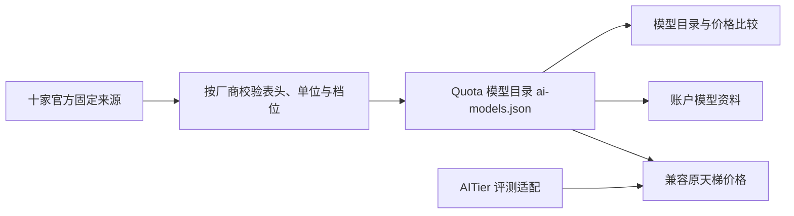

# Quota 1.0.2700 · AI 模型与安装体验

本轮为独立本地功能迭代，基于已经交付的 1.0.2600，展示号与包版本均为 1.0.2700。任务分支 `codex/feat/ai-model-workspace`，依赖前一桌面优化任务的提交。没有推送、合并、创建发布标签或发布 macOS 包。

## 同步错误

实际共享目录中存在 iCloud 的零字节 `UUID(1).json` 冲突副本，同时保留同设备的有效同步包。原代码逐个反序列化全部 JSON，空副本导致「账户同步格式无效，未覆盖本机数据」，中断整个账户同步。

现在先完整校验非空同步包，再判断空文件归属。只有同一 UUID 已有完整且合法的包，空副本才可跳过。保留有效的 `UUID 2.json` / `UUID(1).json` 冲突副本；不删除、不修写云盘文件。没有有效同设备包的空文件仍提示尚未下载完成。非空损坏数据、未知字段、秘密字段、非法 UUID 和时间仍拒绝采用。

`account_sync_migration_checks` 包含空冲突副本、有效冲突副本、缺少有效原件、重复同步、重启、旧台账及未知秘密字段回归。`--inspect-shared <共享目录>` 仅验证账户包，打印有效包数量，不交换数据、不读取凭据、不显示账户内容。

## 自有模型架构：第一阶段

新增「AI 模型」侧栏入口：模型目录、价格对比、来源与更新。目录不再以 AITier 返回的型号列表为前提，十家厂商官方价格表直接发现型号并更新价格。新型号没有可靠能力、上下文或输出限制资料时留空。

默认展示官网当前列出的 116 个型号/版本标识；完整资料保留 136 条记录，其中 18 条历史价格与 2 条未收录标准价可通过筛选查看。厂商归属按原厂和主供应商识别，兼容自定义接口等转售渠道不会改变原厂归属。

`src-tauri/src/ai_models.rs` 管理独立 schema 1 快照、本机缓存、型号标识、厂商、来源、核实时间、标准价、条件档位、缓存 TTL 和更新错误。打包内置官网核实快照，首次打开无需等待联网。更新失败保留上次核实的整条价格记录及时间，标注原因。每日更新可在设置关闭；失败一小时后重试。刷新锁在取消或异常退出时自动释放。

原天梯继续作为评测参考入口。官方价格更新与第三方评分更新分开，后台只读取厂商官网；第三方评分按需更新。升级时把更新的内置价格注入旧天梯，避免旧缓存成功时间阻止修复。没有自行编造新的能力评分。

后续架构顺序：把评测导入统一成带来源、测试集、版本与日期的独立记录；增加多源评测适配与一致性检查；有可复现的评测样本后再形成 Quota 自己的分项视图。未执行的阶段不作为本轮交付成果。

## 官方价格修复

本次实测十个官方来源均成功，共 116 条当前标准 Token 价格记录（含精确版本和别名标识）。历史已核实但本次官网未列出的记录保留原日期并标识沿用，不计入这 116 条。

| 来源 | 本次标准价记录 |
| --- | ---: |
| OpenAI | 37 |
| Kimi | 6 |
| Anthropic | 16 |
| DeepSeek | 4 |
| 智谱 Z AI | 10 |
| Google | 11 |
| 小米 MiMo | 3 |
| 阿里云 | 17 |
| xAI | 8 |
| Meta | 4 |

OpenAI 官网调整了列顺序，且有新的 30 分钟、12 小时缓存写入列。解析器改为按列名含义读取输入、输出和缓存价格，仍校验美元、百万 Token 单位和标准/批量/弹性/长输入档位。价格列顺序不再造成错位；30 分钟、12 小时缓存保留自己的 TTL，不写入旧 5 分钟/1 小时字段。

Kimi Markdown 当前省略价格表；HTML 仍带有完整的静态 DocTable 属性。Markdown 无表时读取同一官方页面的 HTML，严格校验中文表头、人民币、MTok 单位、型号和缓存 TTL，只解析字面量，不运行页面脚本。自动发现包括 `kimi-k3.1-pro` 的新型号。

Anthropic 价格表的产品名与 API ID 分开处理，按官网公开的型号命名规则保存 API 版本中的连字符。精确日期版本在账户模型匹配中优先，防止同族基础别名抢走独立版本价格。其余八家保留各自地域、有效期、标准档与单位约束。

比价最多选择六款，原币种分别显示；未知价格与不可用档位不按免费处理。输入量是累计估算量，单次请求长度决定实际计费档位；缓存写入、工具、存储等费用另计。

来源：[OpenAI 定价](https://developers.openai.com/api/docs/pricing)、[Kimi 定价](https://platform.kimi.com/docs/pricing/chat)、[Claude 定价](https://platform.claude.com/docs/en/about-claude/pricing)、[Claude 型号规则](https://platform.claude.com/docs/en/about-claude/models/model-ids-and-versions)。其他固定入口见 `official_prices::SOURCES`；每条记录单独保存官方 URL 与核实时间。

## 侧栏与配色

侧栏可收起为图标导航，悬停名称、键盘焦点与导航名称保留。收起状态在本机保存。

设置新增 Codex、Claude、VS Code、GitHub、Quota 五套配色，每套支持浅色、深色或跟随系统。配色参考产品视觉风格，并非官方主题包。基础色集中在 `src/lib/appearance.ts`，组件继续使用语义 CSS 变量；本机 `appearance.json` 保存选择，并同步主窗口与用量悬浮窗。修订序号防止快速切换时迟到的旧事件覆盖新选择。默认 Codex 中性灰阶，原 Quota 灰蓝方案仍可选。

## 产品安装向导

普通启动 NSIS 安装包后，提取同版本应用作为隔离安装界面，显示欢迎/语言、安装位置与快捷方式、确认、实际安装状态、完成/打开。界面使用同一套 React 控件、应用图标与中性灰阶；支持中文和英文。升级锁定既有安装位置，保留原来的卸载与升级关系。

确认安装后才运行原 NSIS 的静默安装引擎。实际引擎状态通过独立临时 INI 反馈；安装过程为不定进度，不伪造百分比。只有引擎成功退出且目标 `quota.exe`、`WebView2Loader.dll` 与该安装包内容哈希一致才显示完成。运行中的旧版本无法正常退出时提示用户从托盘退出并重试。安装窗口不初始化账户、凭据、活动采集或云盘同步。

没有 WebView2 或安装界面无法启动时回退到可执行完整安装的原 NSIS 向导。`/S /NS /UPDATE /D=...` 等既有静默升级路径继续保留。没有新增或改变项目许可证授权。

## 验收记录

通过 TypeScript、生产前端构建、`cargo check --locked --offline --examples`、纯逻辑 7/7、组件渲染、SSH 来源/客户端分类、SSH 选择与悬浮窗动效检查。Release examples：`account_sync_checks`、`account_connection_checks`、`account_sync_migration_checks`、`catalog_price_checks`、`official_price_checks`、`ai_model_checks` 全部通过。十家官网实测全部成功，重建的内置快照通过原厂归属、唯一型号、标准价、来源/日期、TTL、条件价及无效估算检查。

账户同步在实际云盘目录进行了只读验证：4 份有效包通过，1 份零字节冲突副本被跳过，5 个文件哈希未变。安装后实际账户同步错误清除；期间出现的一条费用文件暂不可用错误在下一轮自动同步后清除。最终账户、活动与费用三项同步状态均无错误。

浏览器检查七个主页面的浅色/深色、1024px 宽度、账户表单、天梯、设置及横向溢出；另检查五套主题各自深浅色、显式明暗模式覆盖系统模式、快速切换、收起侧栏/重载恢复、新型号、缓存 TTL、比价与官网离线保留。安装向导覆盖新装、升级、失败重试、中文/英文选择、快捷方式、真实请求参数与完成后的打开选择；该部分使用演示安装引擎。

真实 Windows 安装包已解包验证程序及运行库。实际通过现代安装界面将 `D:\Quota` 从 1.0.2600 升级至 1.0.2700：安装 WebView 正常握手、实际 NSIS 引擎运行、完成页在原生 WebView 渲染，安装程序与目标程序/运行库哈希一致，5 个已有个人配置/统计文件哈希未变。安装版使用隔离数据启动 8 秒，通过原生悬浮窗握手、尺寸、命中区域、停靠、托盘、单实例和整体退出检查；普通、最大化、全屏、左分屏几何、还原五种原生窗口轮廓检查通过。完成后恢复正常应用运行。

安装包：`Quota_1.0.2700_x64-setup.exe`，SHA-256：`fa61ed08e9a0837b7ac5e33d18b608660dad08c39fc65a0a4cdf48988167d03b`。

证据：`target/desktop-polish-ui/evidence.json`、`target/ai-workspace-ui/evidence.json`、`target/ai-models-live.json`、`target/installed-2700-modern-upgrade/evidence.json`、同目录 `modern-setup.json` / `live-sync-status.json`、`isolated-data/widget-native-check.json` 与 `frame-data/window-frame-check.json`。浏览器图片为演示数据预览；未把它们当作原生桌面截图。原生安装验收由测试开关驱动同一个安装命令，逐页交互由浏览器演示引擎验证，未执行人工安装器逐页点击。原生轮廓检查为几何/API 验证，本轮未执行手工拖动或系统分屏手势。macOS 构建、签名与运行未执行。
