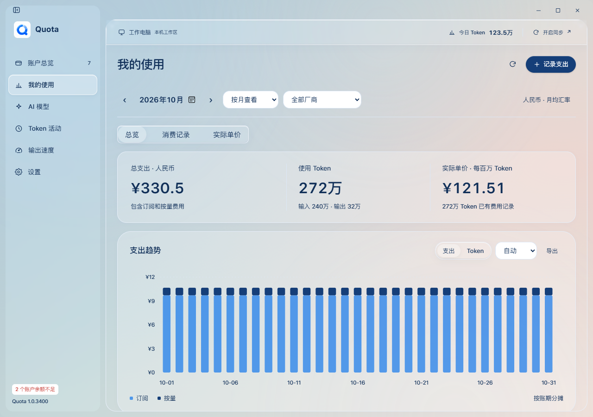
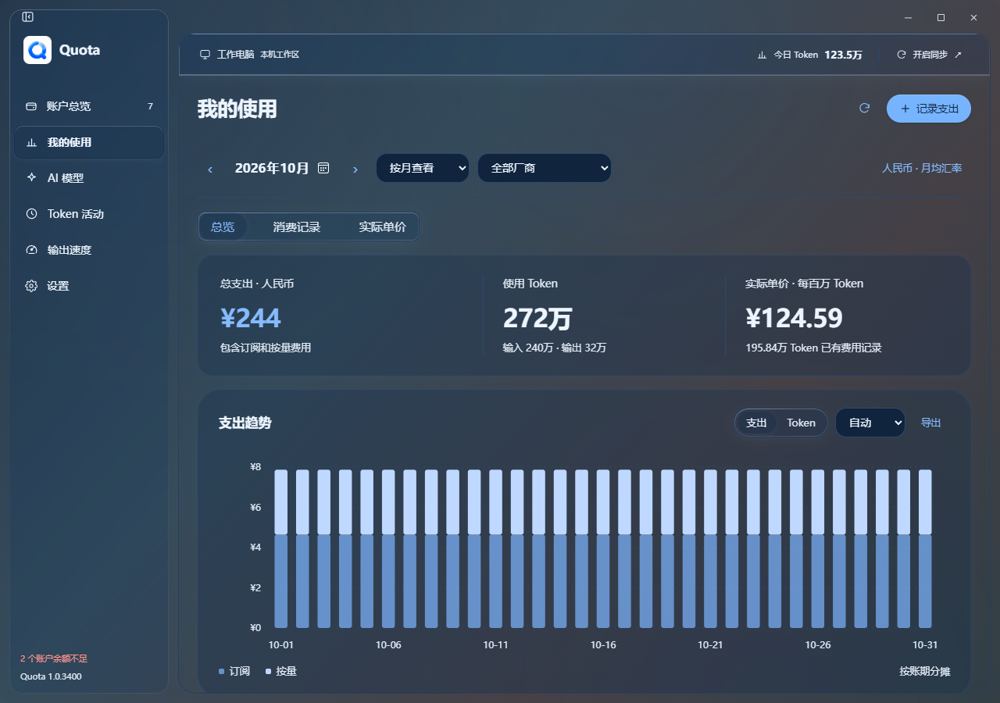
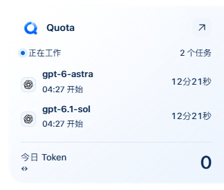

# 1.0.3400 清透玻璃

2026-10-31，Windows本地功能候选，包版本`1.0.3400`。

主程序此前只有半透明卡片，窗口、页面根层和背景光层仍是实色，因此看不到窗口后方的内容。本轮启用主窗口的透明WebView与Windows原生材质，再减少前端叠层。

## 材质与交互

参考[Apple材质指南](https://developer.apple.com/design/human-interface-guidelines/materials)和[Meet Liquid Glass](https://developer.apple.com/videos/play/wwdc2025/219/)，把折射和高光集中在导航、工具栏与分段控件，内容区域使用安静的薄色层，避免整页卡片反复磨砂。

- 原生材质成功后才清空根背景；不可用时保留可读回退，关闭开关恢复原有实底。
- Windows材质保留最低明暗底色，配合更深的文字，保证复杂背景上仍能阅读。
- 导航使用细边缘折射与指针高光；高光逐帧合并更新，移出渐隐后复位，不移动正文和图表。减少动效时保持静止。
- 原生材质按修订同步并缓存，忽略旧请求；高对比度会关闭原生透明合成。
- 主窗口材质与任务悬浮窗分开；悬浮窗继续保留已验证的透明画布及单一裁剪表面。

Quota在Windows上使用系统Acrylic合成与应用内折射。

## 验证进度

- 指针移出时高光从最后位置渐隐，快速移回可打断；键盘聚焦照亮对应控件。滚动和高光保持内容几何，关闭玻璃、失焦、高对比度及减少动效会清理待执行交互。
- 五种主题、深浅模式、六个页面、账户表单和工作/异常任务窗，在黑、白、蓝及混合背景上通过16,320项稳定文字采样。主窗按源码着色值模拟背板，任务窗不加原生着色；正常文字达到4.5、大文字达到3。采样前后校验文字坐标，内容尚在加载时重新采样。这是受控渲染器检查，不代表完整无障碍认证或桌面合成截图。
- 30轮快速配色、模式和开关切换，经交错返回的材质请求仍保留最终选择；跟随系统、强制高对比度、20次侧栏切换及重启恢复通过。500次指针事件合并为1帧，静止1.1秒新增应用RAF为0；这是渲染器观察，不代表DWM帧率。
- 悬停与键盘聚焦通过520组检查，焦点框为2px，按[W3C控件状态对比](https://www.w3.org/WAI/WCAG22/Understanding/non-text-contrast.html)的3:1作参照；悬停文字保持4.5。标题按钮焦点留在按钮内部。另有10组强制高对比度/关闭玻璃检查，焦点对比最低15.13，关闭后恢复原有材质与样式。
- 任务计时在收起或页面不可见时停写文字，展开前刷新当前时间；采集与元数据更新保持原样。稳定合成元数据下，每2.2秒的隐藏计时文字变动由4次降至0次；可见时仍能识别过期状态。实际安装版同样通过收起零变动及重新展开的真实耗时核对。
- TypeScript、前端构建、Rust examples检查、纯逻辑7/7与悬浮窗控制器通过。1024/1360布局、账户表单、人民币月均换算、消费历史、实际Token单价、六维对比及96次调用散点回归通过。
- 打包程序与实际安装版通过原生材质、根层透明像素、修订保护、任务窗权限隔离、高对比度恢复、玻璃开启时最大化/还原；五套配色的明暗切换均保持材质、保存结果与任务窗同步。
- 首轮完成1.0.3300到1.0.3400升级，第四轮完成1.0.3400同版覆盖；引导/安装/完成页、8秒启动、主程序/Loader哈希及5份个人数据保留通过。正常应用已重新打开并通过10秒存活检查。
- 原生窗口浮动、最大化、全屏、分屏及恢复几何通过；任务窗固定画布、命中区域、左右贴边、托盘与退出通过。展开和收起PNG的四个卡片外采样点Alpha均为0。安装版核对77个完整模型配置、29个主力配置、模型分组和两个合成运行任务。
- Windows Computer Use截图重试仍超时。实际桌面合成截图、真实鼠标拖动和系统Snap尚未验证；不将WebView图层截图当作桌面合成结果。macOS本轮未验证。

## 材质对照

以下使用合成背景和资料核对透明层与可读性，示意主程序的材质分层。





任务窗来自实际安装版的隔离资料WebView图层：



## 产物

安装包`Quota_1.0.3400_x64-setup.exe`，3,989,106字节。此为第四轮本地候选；保留前三轮安装包用于回退。

```text
SHA-256 69065748871d3324c29984dab6ce212eef47f3daf2d66dcbd787c94b5f6bbfc6
```

个人资料不用于测试；未推送或公开发布。
