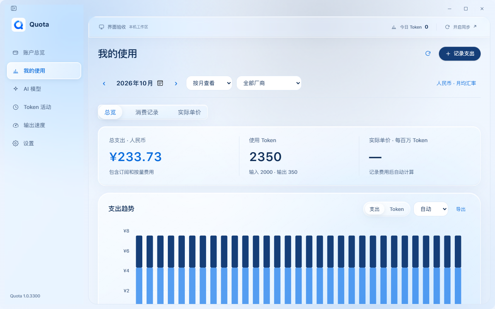
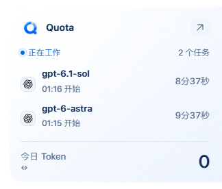
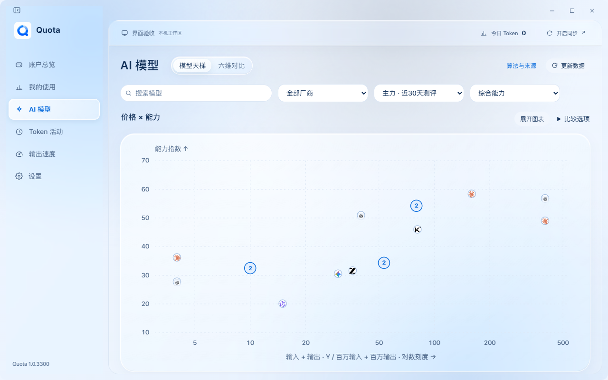

# 1.0.3300 显示与交互修复

2026-10-30，Windows 本地功能交付；包版本 `1.0.3300`。未公开发布或推送。

## 变化

- 输出速度每个点对应一次调用的完成时间与单次速度，不连线、不合并时间桶。保留时长加权总均值、型号对比、模型与设备筛选；记录首屏24条，继续展开可查看全部历史。
- 天梯使用随宽度变化的比例、整齐刻度和明确的对数价格轴。相距不足28像素的型号收为可展开的组，锚点取真实成员，不改动分数或价格；放大时重新布局。
- 玻璃增加通透表面、边缘折射和高光，内容文字保持清晰。悬浮窗关闭整窗 Acrylic，材质只在卡片内部展开，避免透明画布上出现额外矩形。保留原生固定画布及命中区域。
- 我的使用保留人民币月均换算、统一消费历史、实际 Token 单价与简洁表单。悬浮窗继续显示运行任务，不增加无法准确计量的实时速度。

## 检查方式

先打开已安装的1.0.3200，通过真实WebView和Rust后端检查我的使用、设置与模型图。合成费用为20美元订阅和100元按量支出；页面按月均换算显示233.73元，未使用旧手动汇率9.9。实际模型图存在邻近配置重叠、零碎的轴端点刻度，作为本次修复依据。

Windows桌面截图通道两次超时，坐标输入不可用。随后使用隔离资料启动同一个安装程序，通过WebView调试通道读取真实页面和截图。该方式没有替换Tauri接口，个人账户、对话和费用未进入截图或测试资料。

`verify-native-visuals.cjs`仅针对显式指定的空账户隔离资料，验证真实人民币费用、原币文件保留、玻璃设置保存与跨窗口生效、单次调用散点、模型分组、任务列表及展开收起。桌面合成、实际鼠标拖动及系统Snap需与WebView显示检查分别记录。

## 验收

- TypeScript、生产构建、Rust全部examples类型检查及纯逻辑7/7通过；仅保留既有`get_api_key`未使用警告。
- 逐次调用布局检查覆盖10000条记录、相同时间的不同速度、空/单样本、悬停和完整ID。模型检查覆盖相近点不重叠、全部成员保留、真实坐标不改变及极端价格。
- Edge合成资料检查通过1024/1360布局、费用新增/编辑、日期取消/应用、缺失汇率、五套明暗配色、玻璃开关保存和高对比度回退、任务状态、96次散点与全部记录展开、模型分组和放大。

- Windows完成1.0.3200到1.0.3300实际覆盖升级，向导引导、安装阶段与完成页通过；安装主程序和Loader哈希一致，6份既有个人资料文件未变，8秒启动通过。
- 安装程序的原生固定画布、命中区域、左右贴边、反复展开收起、托盘和应用退出通过；程序化浮动、最大化、全屏、分屏与恢复边框检查通过。
- 安装版真实WebView逐条核对77个完整配置、29个当前主力、77个近30天测评配置、六维图与速度汇总。分组成员按各自原始分数校验，未把组锚点分数套给其他成员。
- `verify-native-visuals.cjs`通过真实后端人民币换算、原币文件保留、设置保存和主窗口/任务窗同步、逐次调用图、模型分组及放大、两个运行任务的展开收起。保存的任务窗PNG在卡片外全部透明，收起后仅保留22×100像素标签。
- 安装版外部追加日志检查通过，新记录入库663/1019毫秒；未完成与半行不出速度，最终2350 Token、2个样本、加权均值120 tokens/s。这个数字是记录入库延迟，不是流式测速能力。
- `output_speed_checks`通过完整33次调用、24条之外历史、稳定ID、顺序、模型/设备筛选、暂停恢复和同步去重。
- `activity_checks`通过既有Token去重、历史范围、迁移、异常重试和隐私检查；`ssh_activity_checks`使用明确的Python解释器在本机执行真实投影脚本，通过字段白名单与速度元数据检查，未连接真实SSH主机。
- `sync_storage_checks`通过混合版本、压缩包、重放、损坏隔离和有界解压；`widget_checks`通过自然日统计、排除Trae、缓存/推理子项不重复相加及屏幕/DPI几何。
- 更新后的`verify-benchmark-ui.cjs`通过1024/1360深浅模式的全部公开配置原始分数、分组坐标、六维图与逐次调用；人工延迟读取1.3秒时，自动刷新保留已选调用并接收新记录。棋盘背景探针确认SVG边缘折射产生实际像素变化。
- 补齐既有官方历史快照并运行独立`reference-scenarios.py`后，`benchmark_checks -- --fixtures`通过全部来源黄金值、场景回归及AA完整配置逐条对账；没有改写模型种子或价格资料。

## 安装版画面

以下来自安装版真实WebView及Rust后端，费用、任务和用量均为隔离合成资料；不是个人账单或聊天记录。







## 产物与边界

安装包 `Quota_1.0.3300_x64-setup.exe`，3,984,852字节。

```text
SHA-256 0db23ce9c1b1e7bf01eeb7000f504741ecd2a4a4ced132d75ad2e596f1ca85cb
```

已更新并重新打开 `D:\Quota\quota.exe`。WebView截图和原生几何均已验证；Windows桌面合成截图、真实鼠标拖动及实际系统Snap未验证。本轮未验证macOS、真实SSH或真实双设备传输。未推送或公开发布。
